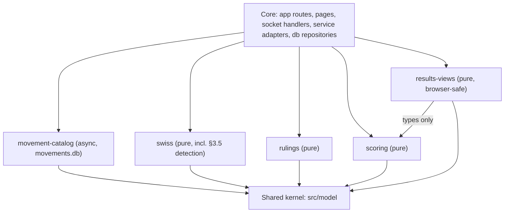
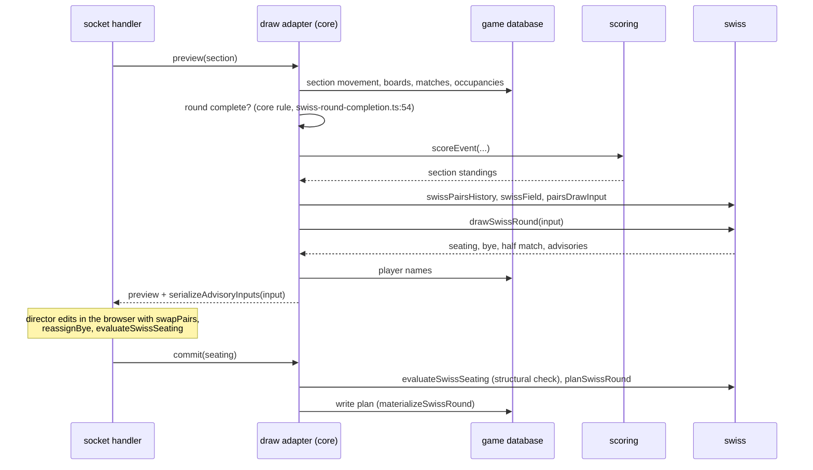
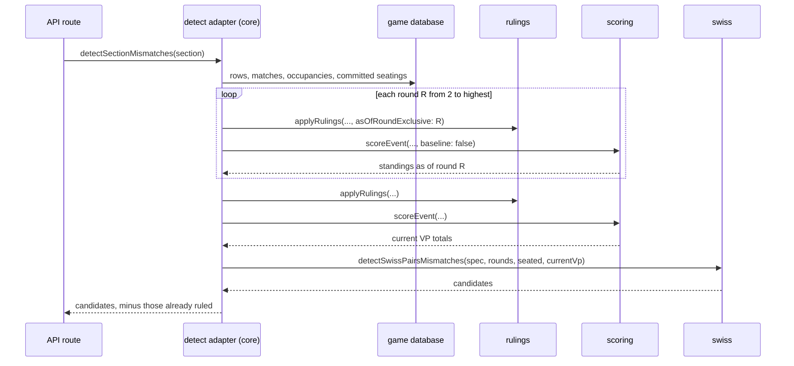
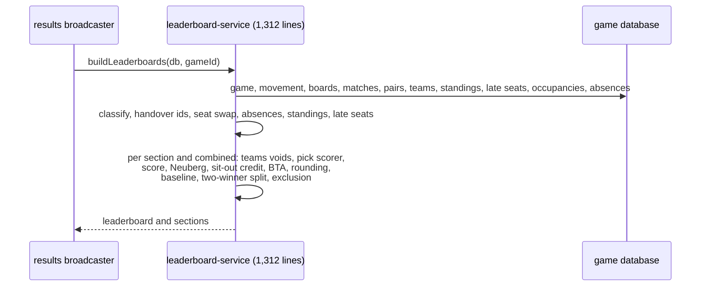
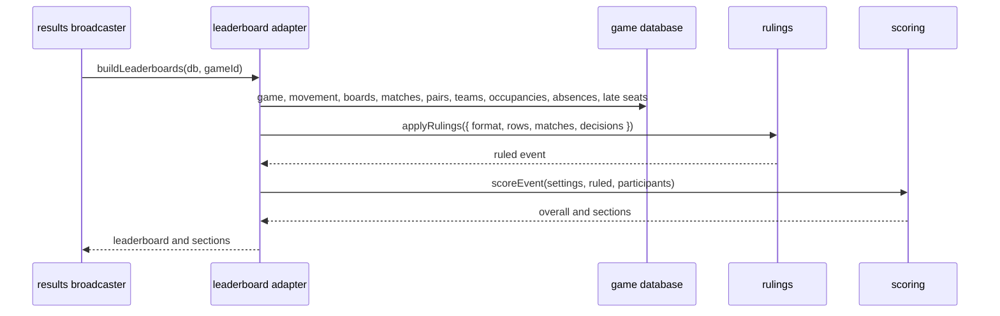

# Module interfaces

Status: **draft for review**. This document defines the public interfaces of
the modules the app is being split into. It changes no code. Implementation is
planned separately once the interfaces are agreed.

Where a code block shows a signature as `(...)`, the function keeps its
current parameters, at the cited line. Functions marked "new" are extracted
from existing code; their exact parameters are settled during implementation.

All `file:line` references are to the code at the time of writing. Line
numbers drift, so treat them as pointers, not contracts.

## 1. Purpose and scope

Domain logic is spread across `src/services`, `src/db` query files, `src/model`,
socket handler folders and React hooks, and nothing stops one layer reaching
into another. The aim is a thin core that only orchestrates, with the domain
logic in modules that each have one small, documented entry point.

In scope:

- Full interfaces for five modules: **movement-catalog**, **swiss**,
  **rulings**, **scoring** and **results-views** (sections 6 to 10).
- The **shared kernel** of types those modules exchange (section 5).
- How the boundaries are enforced (section 4).
- Every other piece of code that could leave the core, ranked (section 11),
  and what the core is left doing (section 12).

Out of scope:

- Changing behaviour. Where two code paths disagree today, the split keeps
  both as they are. Behaviour changes found along the way are listed in
  [`modules-follow-ups.md`](modules-follow-ups.md).
- Moving code. Section 15 gives a suggested order only.

Sources: the code, [`refactor-audit.md`](../../refactor-audit.md) and the other
documents in [`docs/design`](.).

## 2. Principles

1. **The core orchestrates.** Route handlers, socket handlers, service adapters
   and database repositories read and write data, check access, call modules
   and broadcast. They hold no scoring, draw or ruling rules.
2. **Modules are pure unless they own storage.** A pure module takes plain data
   and returns plain data. It does not import React, Next.js, Socket.IO,
   Drizzle, `better-sqlite3`, `fs` or anything under `@/db`, `@/services`,
   `@/socket` or `@/app`. Only the movement catalog owns storage.
3. **One entry point per side.** `src/modules/<name>/index.ts` is the pure
   entry and is safe to use in the browser. A module that does I/O also has
   `src/modules/<name>/server.ts`, which starts with `import "server-only"`.
   Nothing outside a module imports its internal files.
4. **Modules depend on the kernel, not on each other.** The one exception is
   results-views, which reads scoring's output types (types only).
5. **In-process state stays in the core.** State shared between the two server
   bundles must live on `globalThis` (see the cross-bundle rule in the tech
   notes). Modules hold no module-level state. Today's examples that must stay
   in the core: the timer store `src/timer/game-store.ts`, the scheduler
   `src/timer/scheduler.ts` and the sign-in attempt store
   `src/lib/security/sign-in-attempts.ts:34`.
6. **Same answers as today.** Each interface reproduces the current behaviour,
   including where the leaderboard and the export differ today (see
   [`modules-follow-ups.md`](modules-follow-ups.md)).

## 3. Module map

### 3.1 Folder layout

```
src/
  model/                       shared kernel (types and codecs, no dependencies)
  modules/
    movement-catalog/
      index.ts                 pure, browser-safe
      server.ts                server-only (movements.db, movement files)
      storage/                 server-only internals
    swiss/index.ts             pure
    rulings/index.ts           pure
    scoring/index.ts           pure
      methods/<method>/        one sub-folder per scoring method
    results-views/index.ts     pure, browser-safe
  services/                    adapters: read DB, call modules, persist
  db/                          repositories (movements.db is owned by the catalog)
  app/ socket/ hooks/ ...      core
```

The movements database moves inside the module, to
`src/modules/movement-catalog/storage/db/` (decision D12). Its schema, queries,
actions, migrations and the two movement files live there, and
`drizzle.config.movements.ts` points at the new schema path. Only the catalog's
`server.ts` and `storage/` touch it. This is the one exception to the "one
folder per database under `src/db`" rule, which the project structure notes
(`.kiro/steering/structure.md`) will say when the move happens.

### 3.2 Dependencies



| Module                                   | Pure | Browser-safe | May import                                                                          |
| ---------------------------------------- | ---- | ------------ | ----------------------------------------------------------------------------------- |
| kernel (`src/model`)                     | yes  | yes          | itself, `zod`                                                                       |
| movement-catalog `index.ts`              | yes  | yes          | kernel                                                                              |
| movement-catalog `server.ts`, `storage/` | no   | no           | kernel, own `index.ts`, `@/db/open-database`, `fs`, `drizzle-orm`, `better-sqlite3` |
| swiss                                    | yes  | yes          | kernel                                                                              |
| rulings                                  | yes  | yes          | kernel                                                                              |
| scoring                                  | yes  | yes          | kernel                                                                              |
| results-views                            | yes  | yes          | kernel, scoring (types only)                                                        |

Why each module sits where it does:

- **§3.5 mismatch detection is in swiss.** It replays the Swiss draw on
  corrected standings and compares opponents, and its exclusions (bye pair,
  half-match group, triple teams) come from the draw. It only applies to Swiss
  events and takes VP totals as plain data, so swiss never imports scoring.
- **Rulings depends only on the kernel.** It rewrites rows before scoring and
  nothing else.
- **Scoring returns numbers only.** Turning numbers into tables is
  results-views.
- **Event classification is in the kernel**, because rulings needs the event
  format before scoring runs.

## 4. Enforcement

### 4.1 Options compared

|                          | ESLint `no-restricted-imports` | `eslint-plugin-boundaries`                                                                                                                               | `dependency-cruiser`               |
| ------------------------ | ------------------------------ | -------------------------------------------------------------------------------------------------------------------------------------------------------- | ---------------------------------- |
| New dependency           | none (core ESLint rule)        | plugin, plus `eslint-import-resolver-typescript` to resolve `@/`                                                                                         | dev dependency and its own config  |
| Runs in                  | `npm run lint` and the editor  | `npm run lint` and the editor                                                                                                                            | its own CLI, usually in CI         |
| How it matches           | the import string, as written  | resolved file paths classified into element types                                                                                                        | resolved file paths                |
| `@/` alias               | matched as text, works as is   | needs the TypeScript resolver configured                                                                                                                 | reads `tsconfig.json` paths        |
| Relative escapes (`../`) | only if a pattern bans them    | caught (paths are resolved)                                                                                                                              | caught                             |
| Dynamic `import()`       | not checked                    | not checked                                                                                                                                              | checked                            |
| Cycles                   | no                             | no                                                                                                                                                       | yes                                |
| Type-only imports        | `allowTypeImports` option      | supported                                                                                                                                                | supported                          |
| Risk here                | low                            | ESLint 10 compatibility not verified for this repo. The config already carries a workaround for a plugin crash under ESLint 10 (`eslint.config.mjs:28`). | low, but a second tool to maintain |

Facts about `no-restricted-imports` used above are from the
[ESLint rule documentation](https://eslint.org/docs/latest/rules/no-restricted-imports):
it checks static imports only, matches gitignore-style or regex patterns
against the import string, also restricts `export ... from`, and has a
TypeScript-only `allowTypeImports` option. Flat config support and resolver
needs for `eslint-plugin-boundaries` come from its
[README](https://github.com/javierbrea/eslint-plugin-boundaries); I did not
test it against ESLint 10.13 (`package.json:93`).

### 4.2 Recommendation

Use **`no-restricted-imports` blocks in `eslint.config.mjs`**. It adds nothing
to install, runs where developers already look, and the alias problem
disappears if two conventions hold:

- Inside a module, imports between its own folders use `@/modules/<self>/...`,
  never `../`. A pattern bans `../` inside modules, which closes the relative
  escape gap.
- Outside a module, only the entry point is imported.

Two gaps remain and are accepted:

- **Dynamic imports are not checked.** Two exist today and both are in the core,
  where they are allowed: `src/services/draw-swiss-round-service.ts` imports the
  seat-occupancy table dynamically (see `seatedPairIdsForSection`, about line
  145), and `src/db/test/db-int-harness.ts:72` imports the movements database
  (after D12, `@/modules/movement-catalog/storage/db`).
- **Cycles are not detected.** If cycles become a problem, add
  `dependency-cruiser` in CI later. Nothing in the rules below depends on it.

Flat config replaces a rule's options when a later block matches the same file;
it does not merge them. The blocks therefore use `ignores` so that no file is
matched by two blocks setting this rule.

### 4.3 Draft rules (not applied)

To be added to `eslint.config.mjs` when the first module lands. Check each
block against a small fixture file before adopting it, because gitignore
negation is order-sensitive.

```js
// Packages a pure module or the kernel must never import.
const IO_AND_FRAMEWORKS = [
  "react",
  "react-dom",
  "next",
  "next/*",
  "socket.io",
  "socket.io-client",
  "drizzle-orm",
  "drizzle-orm/*",
  "better-sqlite3",
  "fs",
  "fs/*",
  "node:*",
  "child_process",
  "server-only",
];

const noParentRelative = {
  group: ["../*"],
  message: "Inside a module use @/modules/<self>/...; never climb out with ../",
};

/** Rule block for one module: kernel plus the listed modules only. */
function moduleBlock(
  name,
  { files, ignores = [], allow = [], io = false, extraPaths = [] },
) {
  return {
    files,
    ignores,
    rules: {
      "no-restricted-imports": [
        "error",
        {
          paths: extraPaths,
          patterns: [
            noParentRelative,
            ...(io
              ? []
              : [
                  {
                    group: IO_AND_FRAMEWORKS,
                    message: `${name} is pure: no framework or I/O imports.`,
                  },
                ]),
            {
              group: [
                "@/*",
                "!@/model",
                "!@/modules",
                "@/modules/*",
                `!@/modules/${name}`,
                ...allow.map((a) => `!${a}`),
              ],
              message: `${name} may import only the kernel (@/model)${allow.length ? `, ${allow.join(", ")}` : ""}.`,
            },
          ],
        },
      ],
    },
  };
}

export const moduleBoundaries = [
  // Kernel: depends on nothing but itself and zod.
  {
    files: ["src/model/**/*.{ts,tsx}"],
    rules: {
      "no-restricted-imports": [
        "error",
        {
          patterns: [
            { group: IO_AND_FRAMEWORKS, message: "The kernel is pure." },
            {
              group: ["@/*", "!@/model"],
              message: "The kernel may import only itself.",
            },
          ],
        },
      ],
    },
  },

  moduleBlock("swiss", { files: ["src/modules/swiss/**/*.{ts,tsx}"] }),
  moduleBlock("rulings", { files: ["src/modules/rulings/**/*.{ts,tsx}"] }),
  moduleBlock("scoring", { files: ["src/modules/scoring/**/*.{ts,tsx}"] }),
  moduleBlock("results-views", {
    files: ["src/modules/results-views/**/*.{ts,tsx}"],
    allow: ["@/modules/scoring"],
    extraPaths: [
      {
        name: "@/modules/scoring",
        allowTypeImports: true,
        message: "results-views may use scoring's types only.",
      },
    ],
  }),

  // Catalog, pure side.
  moduleBlock("movement-catalog", {
    files: ["src/modules/movement-catalog/**/*.{ts,tsx}"],
    ignores: [
      "src/modules/movement-catalog/server.ts",
      "src/modules/movement-catalog/storage/**",
    ],
  }),
  // Catalog, server side: may also reach its own database.
  moduleBlock("movement-catalog", {
    files: [
      "src/modules/movement-catalog/server.ts",
      "src/modules/movement-catalog/storage/**/*.{ts,tsx}",
    ],
    io: true,
    allow: ["@/db/open-database"],
  }),

  // Core: modules only through their entry points; movements.db only via the catalog.
  {
    files: ["src/**/*.{ts,tsx}", "tests/**/*.ts", "scripts/**/*.{ts,mjs}"],
    ignores: ["src/modules/**", "src/model/**", "src/db/test/**"],
    // movements.db now lives in the catalog's storage/, so the internals
    // pattern below also stops the core reaching it directly.
    rules: {
      "no-restricted-imports": [
        "error",
        {
          patterns: [
            {
              group: [
                "@/modules/*/*",
                "!@/modules/movement-catalog/server",
                "**/modules/*/*",
                "!**/modules/movement-catalog/server",
              ],
              message: "Import a module through its entry point only.",
            },
          ],
        },
      ],
    },
  },
];
```

`server.ts` starting with `import "server-only"` also makes any import of it
from a client component fail the build, so the browser-safe split needs no
extra lint rule.

### 4.4 Check: diagram against rules

| Edge                                                                       | Allowed?        | Rule that enforces it                                                   |
| -------------------------------------------------------------------------- | --------------- | ----------------------------------------------------------------------- |
| core → any module entry                                                    | yes             | core block allows `@/modules/<name>` and the catalog `server` entry     |
| core → module internals                                                    | no              | core block, first pattern                                               |
| core → movements.db (catalog `storage/`)                                   | no              | core block, internals pattern                                           |
| catalog → kernel                                                           | yes             | `!@/model` in the catalog blocks                                        |
| catalog server → its own `storage/db`, `fs`, Drizzle                       | yes             | server block: `io: true`, own folder re-included                        |
| catalog pure side → I/O                                                    | no              | pure catalog block, `IO_AND_FRAMEWORKS`                                 |
| swiss → kernel                                                             | yes             | `!@/model`                                                              |
| swiss → scoring, rulings, catalog                                          | no              | `@/modules/*` with only `!@/modules/swiss` re-included                  |
| rulings → kernel only                                                      | yes / no others | as swiss                                                                |
| scoring → kernel only                                                      | yes / no others | as swiss                                                                |
| results-views → scoring types                                              | yes             | `allow` re-includes, `extraPaths` with `allowTypeImports` blocks values |
| results-views → scoring values                                             | no              | `extraPaths`                                                            |
| any module → `@/db`, `@/services`, `@/socket`, `@/app`, `@/lib`, `@/hooks` | no              | the `@/*` group, not re-included                                        |
| module → another module via `../`                                          | no              | `noParentRelative`                                                      |
| kernel → anything outside `src/model`                                      | no              | kernel block                                                            |

## 5. Shared kernel (`src/model`)

The kernel is the set of plain types and string codecs that more than one
module, or a module and the core, need to agree on. Most of it already exists in
`src/model`. The changes are to give it plain row types instead of Drizzle
types, and to remove its imports from `@/db` and `@/scoring`.

### 5.1 Row and record types

These replace the Drizzle `Board` (`src/db/games/tables/boards.ts:61`) and
`Match` (`src/db/games/tables/matches.ts:101`) types inside modules. Adapters
map rows to them once, after reading. Each field is a column of the same name.

```ts
// src/model/result-row.ts (new)
import type { BoardOutcome } from "./score";
import type { Card } from "./common";

/** From BoardStatuses, src/db/games/types/board-status.ts:1 (moves here). */
export type BoardStatus =
  | "NOT_PLAYED"
  | "PENDING_CONFIRMATION"
  | "CONFIRMED"
  | "OVERRIDDEN"
  | "CANCELLED"
  | "REMOVED_TEAMS"
  | "SIT_OUT"
  | "HALF_AVERAGE"
  | "ABSENT";

/** One board played at one table in one round (the `boards` table). */
export interface ResultRow {
  section: string;
  roundNumber: number;
  tableNumber: number;
  boardNumber: number;
  copy: string;
  ns: string;
  ew: string;
  confirmedResult: BoardOutcome | null;
  confirmedLead: Card | null;
  /** Director override, or an encoded ruling (adjusted score, removed board). */
  directorOverrideResult: BoardOutcome | null;
  directorOverrideLead: Card | null;
  matchId: number;
  status: BoardStatus | null;
  seatsSwapped: boolean;
}

/** From the `matches.kind` enum, src/db/games/tables/matches.ts:104 (moves here). */
export type MatchKind = "PAIRS" | "TEAMS" | "TRIPLE" | "HALF_MATCH" | "BYE";

/** One first-class match (the `matches` table). */
export interface MatchRow {
  id: number;
  section: string;
  roundNumber: number;
  kind: MatchKind;
  scoredAsUnit: boolean;
  home: string;
  opponent: string | null;
  groupId: string | null;
  slot: number | null;
  vpPool: number | null;
  boardStart: number;
  boardEnd: number;
  /** Decoded once by the adapter with decodeMatchRuling (5.3). */
  ruling: MatchRuling | null;
}
```

The seven structural row types that exist today become `Pick`s of these, so no
module defines its own row shape:

| Today                                                              | Becomes                                              |
| ------------------------------------------------------------------ | ---------------------------------------------------- |
| `SwissVpBoardRow` `src/scoring/swiss/swiss-vp-overall.ts:18`       | `Pick<ResultRow, ...>`                               |
| `SwissVpMatchRow` `src/scoring/swiss/swiss-vp-round.ts:30`         | `Pick<MatchRow, ...>`                                |
| `TeamMatchRow` `src/scoring/swiss/team-match.ts:80`                | `Pick<ResultRow, ...>` plus the joined `matchRuling` |
| `TeamMatchStructureRow` `src/scoring/swiss/team-match.ts:52`       | `Pick<MatchRow, ...>`                                |
| `AbsenceBoardRow` `src/model/absence.ts:48`                        | `Pick<ResultRow, ...>`                               |
| `StandingBoardRow` `src/db/games/queries/ranking-exclusions.ts:31` | `Pick<ResultRow, ...>`                               |
| `SeatSwappable` `src/model/seat-swap.ts:6`                         | `Pick<ResultRow, "ns" \| "ew" \| "seatsSwapped">`    |

```ts
// src/model/occupancy.ts (new)
/**
 * The scoring-relevant columns of a seat_occupancy row
 * (SeatOccupancy, src/db/games/tables/seat-occupancy.ts:193). Player ids and
 * the seat's secret key are left out on purpose: no module needs them, and the
 * secret must not travel further than the repository.
 */
export interface OccupancyRecord {
  id: number;
  seat: PairSeat;
  anchorId: string | null;
  boards: number[] | null;
  standing: "ACTIVE" | "WITHDRAWN" | "WITHOUT_STANDING" | "LATE";
  withdrawnInRound: number | null;
  withdrawalTreatment: "REMOVE" | "PENALISED" | "AVERAGE" | "REMOVED" | null;
  withdrawalFinePercent: number | null;
  isArrivalAnchor: number;
  isMainLine: number;
  split: number;
}
```

`ParticipantStanding` and `WithdrawalRecord` move from
`src/db/games/queries/ranking-exclusions.ts:13` and `:47` into the kernel
unchanged.

### 5.2 Movement plan

The plan is what movement-catalog and swiss produce and what the core writes
into the game database. Today the same idea has three names:
`MaterializableMovement` (`src/services/materialize-movement.ts:82`),
`RehydratedTable` (`src/services/movement-rehydration.ts:34`) and the generated
`Tables` (`src/model/movement.ts:55`).

```ts
// src/model/movement-plan.ts (new). Moved from services/materialize-movement.ts.
export interface MatchDescriptor {
  /* as materialize-movement.ts:31, unchanged */
}
export interface PlannedRound {
  /* as MaterializableRound, materialize-movement.ts:46 */
}
export interface PlannedTable {
  tableNumber: number;
  rounds: PlannedRound[];
}
export type MovementPlan = PlannedTable[];
```

`Tables` stays as the generators' output shape. `RehydratedTable` goes away:
it is a plan without sit-outs or match descriptors, which `PlannedRound`
already expresses with those fields unset.

### 5.3 Codecs and constants

The kernel keeps the string formats stored in the database, so every module
reads them the same way.

| Codec                        | Location                                        | Change                                                                                                                                                                                   |
| ---------------------------- | ----------------------------------------------- | ---------------------------------------------------------------------------------------------------------------------------------------------------------------------------------------- |
| Adjusted and weighted scores | `src/model/adjusted-score.ts:92`, `:133`        | none                                                                                                                                                                                     |
| Teams match void `VOID:`     | `src/model/teams-match-void.ts:71`, `:81`       | the VP and boards-won maths (`voidFlatVp` `:97`, `voidSplitVp` `:112`, `voidMatchVp` `:169`, `voidMatchWon` `:261`) moves to scoring, which removes the kernel's import of `impVpWinner` |
| Pairs match void `VOIDP:`    | `src/model/pairs-match-void.ts:50`, `:60`       | `PairVoidFault` moves into the kernel from `src/scoring/swiss/swiss-half-match.ts:175`                                                                                                   |
| Mismatch ruling `MM:`        | `src/model/swiss-mismatch.ts:79`, `:93`, `:127` | `adjustMismatchVp` (`:153`, the §3.5.2 adjustment) moves to scoring                                                                                                                      |
| Removed teams board          | `src/model/teams-removed-board.ts`              | none                                                                                                                                                                                     |
| AVE± constants               | `src/scoring/artificial-score.ts:17`–`:25`      | move into the kernel; `src/model/absence.ts` stops importing scoring                                                                                                                     |
| `decodeMatchRuling`          | new                                             | one function over the three match codecs, used by adapters to fill `MatchRow.ruling`                                                                                                     |

### 5.4 Event types and classification

```ts
// src/model/game-types.ts (new). Moved from src/db/games/types/*.
export type GameType = "PAIRS" | "TEAMS";                 // game-type.ts:3
export type ScoringType = "MP" | "IMP" | "IMP_VP" | "XIMP" | "BAM" | "PAB"; // scoring-type.ts:10
export type GameFormat = "STANDARD" | "SWISS";            // db/games/types/event-format.ts
export type TournamentLevel = /* tournament-level.ts */;
```

The database type files re-export from the kernel, so the Drizzle schema keeps
using them and the dependency points the right way (db → model).

Two different types are both called `EventFormat` today: the game's
STANDARD/SWISS column (`src/db/games/types/event-format.ts`) and the scoring
format (`src/model/event-format.ts:26`). The kernel names the first
`GameFormat` and the second `ScoringFormat`, so neither name is ambiguous.

`classifyEvent` (`src/model/event-format.ts:131`), `EventClassification`
(`:48`), `SwissVpMode` (`:42`) and `isTwoWinnerPairs` (`:120`) stay in the
kernel. Rulings needs the format to choose its rewrite steps, and scoring
needs it to choose a method.

### 5.5 Other shared pieces

- **Selected movement.** The Zod schemas and helpers in
  `src/model/selected-movement.ts` stay in the kernel, except
  `stationaryPairsForRound` (`:151`) and `withStationaryHistory` (`:178`), which
  are Swiss rules and move to swiss.
- **Teams match layout.** `TeamsMatch`, `TeamsSeatPlacement`, `teamIds` and
  `expandTeamMatches` (`src/movement/swiss-teams/swiss-teams-pairing.ts:66`,
  `:212`, `:229`, `:542`) move into the kernel. Both swiss and the
  round-robin generator in the catalog use them, and modules may not import
  each other.
- **Participants.** `src/model/participants.ts` is used almost everywhere and
  stays shared kernel. It imports `NewPlayer` and `Player` from
  `src/db/games/tables/players`; it gets a plain `PlayerRecord` type instead.
- **Leaderboard output types.** `src/model/leaderboard.ts` stays in the kernel.
  Scoring produces these types and results-views and the client consume them.

### 5.6 Check: leaks from pure code, before and after

Every import from `@/db`, `@/services`, `@/socket` or `@/scoring` found in
`src/model`, `src/movement`, `src/scoring`, `src/timer` and `src/lib/usebio`,
plus the two known cases elsewhere.

| File                                                                          | Imports today                                                                                | After                                                                       |
| ----------------------------------------------------------------------------- | -------------------------------------------------------------------------------------------- | --------------------------------------------------------------------------- |
| `src/model/absence.ts`                                                        | `AVE_*_PERCENT` from `@/scoring/artificial-score`                                            | kernel constants                                                            |
| `src/model/pairs-match-void.ts`                                               | `PairVoidFault` from `@/scoring/swiss/swiss-half-match`                                      | kernel type                                                                 |
| `src/model/teams-match-void.ts`                                               | `ImpVpPool`, `impVpWinner` from `@/scoring/swiss/imp-vp-table`                               | VP maths moves to scoring; codec has no imports                             |
| `src/model/event-format.ts`                                                   | `GameType`, `ScoringType` from `@/db/games/types`                                            | kernel types                                                                |
| `src/model/event-type-choice.ts`                                              | `GameType`, `EventFormat`, `ScoringType` from `@/db/games/types`                             | kernel types (`GameFormat`)                                                 |
| `src/model/participants.ts`                                                   | `NewPlayer`, `Player` from `@/db/games/tables/players`                                       | `PlayerRecord`                                                              |
| `src/model/tournament-level.ts`                                               | `TournamentLevel` from `@/db/games/types`                                                    | kernel type                                                                 |
| `src/movement/mitchell/sit-out.ts`                                            | `MaterializableMovement`, `MaterializableRound` from `@/services/materialize-movement`       | `MovementPlan`, `PlannedRound`                                              |
| `src/movement/spec-sit-out.ts`                                                | `RehydratedTable` from `@/services/movement-rehydration`; `Materializable*`                  | `MovementPlan`                                                              |
| `src/movement/recommendations/spec-map-recommendations.ts`                    | `PairMovementSpec` from `@/db/movements/schema`                                              | catalog type `CatalogMovementSummary` (6.2)                                 |
| `src/movement/round-robin-teams/round-robin-teams-pairing.ts`                 | `TeamsMatch`, `expandTeamMatches`, `teamIds` from swiss-teams                                | kernel teams match layout                                                   |
| `src/scoring/plugins/types.ts`, `registry.ts`, `traveller/score-traveller.ts` | `ScoringType` from `@/db/games/types`                                                        | kernel type                                                                 |
| `src/scoring/swiss/detect-mismatch.ts`, `detect-teams-mismatch.ts`            | `drawSwissRound`, `drawSwissTeamsRound` and types from `@/movement/swiss*`                   | both files move into swiss                                                  |
| `src/lib/usebio/assemble-*.ts` (4 files)                                      | `Board`, `BridgeGame`, `Club`, `TournamentLevel` from `@/db`                                 | `ResultRow`, an export snapshot type, kernel `TournamentLevel` (section 11) |
| `src/lib/usebio/generate-usebio.ts`                                           | `ScoringType`, `TournamentLevel` from `@/db/games/types`                                     | kernel types                                                                |
| `src/timer/game-store.ts`, `src/timer/promote-timer.ts`                       | timer queries and actions from `@/db`; `makeTimerBroadcaster` from `@/socket/handlers/timer` | stay in the core as the timer adapter (section 11)                          |
| `src/socket/handlers/game/submit-result/reconcile-submissions.ts`             | `BoardSubmission` from `@/db/games/tables/submissions`                                       | kernel `Submission` type (section 11)                                       |
| `src/lib/board-labels.ts`                                                     | `OutstandingBoard` from `@/db/games/queries/get-outstanding-boards`                          | client helper, stays core; move the type to the kernel                      |

## 6. movement-catalog

Owns every movement whose schedule is fixed before play: the stored catalogue
in `movements.db`, the `PSMovements.txt` / `TSMovements.txt` files it is seeded
from, the recommendations, and the generators for Mitchell variants and Teams
Round Robin. Swiss movements are drawn round by round and belong to swiss.

### 6.1 What moves in

- `src/movement/**` except `swiss/` and `swiss-teams/`.
- `src/services/movement-rehydration.ts` (whole file).
- The pure plan builders in `src/services/materialize-movement.ts`:
  `tablesToMaterializableMovement` (`:412`), `mitchellToPairMovement` (`:462`)
  and `roundRobinTeamsToMaterializable` (`:488`).
- The sit-out choice `applySitOut` in `src/services/start-game-service.ts:82`.
- `src/db/movements/**`, moved into `storage/db/` (see 3.1).

Writing a plan into the game database (`buildSectionRows` `:180`,
`insertSectionDrafts` `:294`, `materializeSections` `:355`) stays in the core.

### 6.2 Pure entry: `@/modules/movement-catalog`

Used by the movement picker and preview in the browser, and by hooks.

```ts
// Generation (source: src/movement/mitchell/mitchell.ts:72)
export function generateMitchell(spec: MitchellMovementSpec): Tables;
export type { MitchellMovementSpec }; // mitchell-utils.ts:3

// Recommendations. Pure: the stored movements are passed in, because the
// picker computes recommendations in the browser today
// (SectionMovementPicker.tsx calls recommendationsFromSpecMap directly).
export function recommendMovements(
  tables: number,
  stored: CatalogMovementSummary[],
): RecommendedMovement[]; // spec-map-recommendations.ts:194
export type { RecommendedMovement, RecommendedMovementSpecRef }; // recommendation-types.ts:49, :29

/** A stored movement's summary row, replacing Drizzle's PairMovementSpec in callers. */
export interface CatalogMovementSummary {
  id: number;
  name: string;
  type: string;
  tables: number;
  boards: number;
  boardsPerRound: number;
  rounds: number;
  missingPair: number | null;
}

// Display shapes and helpers (movementData.ts:7, :27, :53, :69;
// table-placement.ts:11, :82, :127, :148; shared.ts:151)
export type { MovementByTable, MovementByRound, TablePlacement, RelayContext };
export function generatedToMovementByTable(
  generated: Tables,
): MovementByTable[];
export function buildRounds(tables: MovementByTable[]): MovementByRound[];
export function buildTablePlacement(
  tables: MovementByTable[],
): Map<number, TablePlacement>;
export function withRelay(
  p: Map<number, TablePlacement>,
  ctx: RelayContext,
): Map<number, TablePlacement>;
export function boardRangeForSet(
  boardSet: number,
  boardsPerRound: number,
): { boardStart: number; boardEnd: number };
```

### 6.3 Server entry: `@/modules/movement-catalog/server`

```ts
import "server-only";

/** Stored movements for a table count. Source: get-movements.ts:5. */
export function listPairMovements(
  tables: number,
): Promise<CatalogMovementSummary[]>;

/**
 * One stored movement laid out by table, as the detail route builds it today
 * (app/api/movements/detail/[movementType]/[movementId]/route.ts, using
 * get-movement.ts:16, :40, get-movement-spec.ts:16, :32 and shared.ts:151).
 * The route keeps its HTTP shape and just returns this.
 */
export function getMovementDetail(
  kind: "pairs" | "teams",
  id: number,
  boardsPerRound?: number,
): Promise<MovementDetail | null>;

/** A fixed movement selection (everything except the two Swiss sources). */
export type FixedSelectedMovement = Extract<
  SelectedMovement,
  { source: "SPEC" | "MITCHELL" | "ROUND_ROBIN_TEAMS" }
>;

/**
 * The complete plan for a fixed movement, with the sit-out applied.
 * Replaces, in one call:
 *   rehydrateSelectedMovement (movement-rehydration.ts:100),
 *   applySitOut (start-game-service.ts:82) and the three sit-out helpers
 *   (mitchell/sit-out.ts:58, spec-sit-out.ts:74, :108),
 *   generateRoundRobinTeams + roundRobinTeamsToMaterializable
 *   (round-robin-teams-pairing.ts:143, materialize-movement.ts:488).
 */
export function planMovement(
  selected: FixedSelectedMovement,
  options: { sitOutSeat: PairSeat | null },
): Promise<MovementPlan>;

/** Wipe and reseed movements.db from the movement files. Source: refresh-movements.ts:48. */
export function refreshCatalog(): Promise<{ pairs: number; teams: number }>;

/** Run the movements.db migrations. Source: db/movements/migrate.ts:4. */
export function runCatalogMigrations(): Promise<void>;

/** Maintenance: rebuild the committed recommendation snapshot (recommendation-spec-map.ts:63). */
export function buildRecommendationSnapshot(): RecommendationSpecMap;

/** Maintenance: how well the recommendation table maps onto the catalogue (spec-catalog.ts:15 + resolve-recommendation.ts:194). */
export function recommendationCoverage(): RecommendationCoverageReport;
```

### 6.4 Back-edges removed

| Today                                                                                                       | After                                                                                         |
| ----------------------------------------------------------------------------------------------------------- | --------------------------------------------------------------------------------------------- |
| `fs` read in `src/movement/shared.ts:68` (`splitLinesOfFile`)                                               | moves to `storage/`; `generatePairsMovements` and `generateTeamsMovements` become server-only |
| `fs` read in `src/movement/recommendations/recommendation-spec-map.ts:52`                                   | moves to `storage/` (maintenance only, no runtime caller)                                     |
| sit-out helpers import service types                                                                        | use the kernel `MovementPlan`                                                                 |
| `PairMovementSpec` from the Drizzle schema in `spec-map-recommendations.ts` and `SectionMovementPicker.tsx` | `CatalogMovementSummary`                                                                      |
| Round Robin imports from swiss-teams                                                                        | kernel teams match layout (5.5)                                                               |
| `Movement` in `src/movement/shared.ts:39` has the same name as `Movement` in `src/model/movement.ts:62`     | renamed `MovementFileEntry` inside the module                                                 |

The movements database connection is a module-level cache in each bundle
(`src/db/movements/index.ts:11`). That is fine: it holds a connection, not
shared state, so having one per bundle changes nothing.

### 6.5 Check: callers

Every non-test caller of `src/movement/**` (excluding Swiss) and
`src/db/movements/**`, found by grep.

| Caller                                                                 | Uses today                                                                                                                                                    | After                                                                                   |
| ---------------------------------------------------------------------- | ------------------------------------------------------------------------------------------------------------------------------------------------------------- | --------------------------------------------------------------------------------------- |
| `src/app/api/movements/pairs/[tables]/route.ts`                        | `getPairMovementSpecsForTables`                                                                                                                               | `listPairMovements`                                                                     |
| `src/app/api/movements/detail/[movementType]/[movementId]/route.ts`    | `getPairMovement`, `getTeamMovement`, `get*SpecById`, `boardRangeForSet`, `MovementByTable`                                                                   | `getMovementDetail`                                                                     |
| `src/app/game/[gameId]/create/RecommendedMovementCard.tsx`             | `RecommendedMovement`                                                                                                                                         | type from pure entry                                                                    |
| `src/app/game/[gameId]/manage/movement/ManageMovementPage.tsx`         | `MovementByTable`                                                                                                                                             | type from pure entry                                                                    |
| `src/components/manage/sections/MovementPreviewDialog.tsx`             | `RecommendedMovement`, `MovementByTable`, `generatedToMovementByTable`, `generateMitchell`                                                                    | pure entry                                                                              |
| `src/components/manage/sections/SectionMovementPicker.tsx`             | `PairMovementSpec`, `RecommendedMovement`, `recommendationsFromSpecMap`                                                                                       | `CatalogMovementSummary`, `recommendMovements`                                          |
| `src/components/manage/sections/movement-recommendations.ts`           | `RecommendedMovement`, `RecommendedMovementSpecRef`                                                                                                           | types from pure entry                                                                   |
| `src/components/movement/MovementDetailView.tsx`                       | `buildRounds`, `MovementByTable`                                                                                                                              | pure entry                                                                              |
| `src/components/movement/MovementRound.tsx`                            | `MovementByRound`                                                                                                                                             | type from pure entry                                                                    |
| `src/components/movement/MovementTable.tsx`                            | `MovementByTable`                                                                                                                                             | type from pure entry                                                                    |
| `src/hooks/movement-round-info.ts`                                     | `MovementByTable`                                                                                                                                             | type from pure entry                                                                    |
| `src/hooks/selected-movement-name.ts`                                  | `MitchellMovementSpec`                                                                                                                                        | type from pure entry                                                                    |
| `src/hooks/stationary-pairs.ts`                                        | `MovementByTable`, `generatedToMovementByTable`, `generateMitchell`, `buildTablePlacement`, `withRelay`, `TablePlacement`                                     | pure entry (and `swissPairHomeSeat` from swiss, 7.5)                                    |
| `src/lib/game-service.ts`, `src/lib/section-service.ts`                | `MitchellMovementSpec`                                                                                                                                        | type from pure entry                                                                    |
| `src/socket/handlers/game/select-movement/select-movement.handler.ts`  | `MitchellMovementSpec`                                                                                                                                        | type from pure entry                                                                    |
| `src/services/movement-rehydration.ts`                                 | `getPairMovement`, `getPairMovementSpecById`, `generateMitchell`, `boardRangeForSet`                                                                          | moves inside the module (`planMovement`)                                                |
| `src/services/start-game-service.ts`                                   | `generateStandardMitchellWithSitOut`, `applySpecSitOutNoMissingPair`, `alignSpecMissingPair`, `generateRoundRobinTeams`; `rehydrateSelectedMovement` (`:133`) | `planMovement`                                                                          |
| `src/scripts/migrate.ts`                                               | `runMovementsMigrations`                                                                                                                                      | `runCatalogMigrations`                                                                  |
| `src/scripts/seed-movements.ts`, `sync-movements.ts`, `e2e-prepare.ts` | `runMovementsMigrations`, `refreshMovements`                                                                                                                  | `runCatalogMigrations`, `refreshCatalog`                                                |
| `src/scripts/e2e-seed/seed-game.ts`                                    | `getPairMovementSpecsForTables`, `recommendationsFromSpecMap`                                                                                                 | `listPairMovements`, `recommendMovements`                                               |
| `scripts/coverage-report.mjs`                                          | `buildSpecCatalog`, `resolveRecommendationDescriptor` (relative paths into `src/movement`)                                                                    | `recommendationCoverage`                                                                |
| `scripts/build-sync-movements.mjs`                                     | copies the two `.txt` files into `dist/`                                                                                                                      | path update only, if the files move into `storage/`                                     |
| `scripts/dump-db-movements.mjs`                                        | not read for this document                                                                                                                                    | to check during implementation (Q17)                                                    |
| `src/db/test/db-int-harness.ts:72`                                     | dynamic import of `@/db/movements`                                                                                                                            | path update; test infrastructure, exempt (`src/db/test/**` is ignored by the core rule) |

Unchanged: `src/app/api/games/[gameId]/movement/route.ts` and
`src/services/movement-service.ts:17` read the movement already written to the
game database, so they do not touch the catalog.

## 7. swiss

Owns the round-by-round draw for Swiss Pairs and Swiss Teams: the draw
engines, director edits and advisories, the round-1 layout, board ranges, the
pair and team id encoding, stationary-pair history, turning a drawn round into
a plan, and EBU §3.5 mismatch detection.

The engines are already pure: `src/movement/swiss/swiss-pairing.ts` imports
only `PairDirection` from `@/model/common`, and
`src/movement/swiss-teams/swiss-teams-pairing.ts` imports nothing. The work is
pulling in the pure Swiss helpers that sit in services and database query
files, and stopping those layers importing engine internals.

### 7.1 What moves in

| Code                             | From                                                                                                                                                                                                                                                  |
| -------------------------------- | ----------------------------------------------------------------------------------------------------------------------------------------------------------------------------------------------------------------------------------------------------- |
| Pairs engine, edits, advisories  | `src/movement/swiss/swiss-pairing.ts` (whole file)                                                                                                                                                                                                    |
| Standings display entry          | `src/movement/swiss/swiss-standings.ts:11`                                                                                                                                                                                                            |
| Teams engine, edits, advisories  | `src/movement/swiss-teams/swiss-teams-pairing.ts`, except the teams match layout, which goes to the kernel (5.5)                                                                                                                                      |
| Pair id encoding                 | `swissPairMovementId` `src/services/materialize-swiss-round.ts:44`                                                                                                                                                                                    |
| Pair id decoding                 | `swissPairIdFromParticipant`, `swissPairIdFromSeat` `src/db/games/queries/swiss-board-history.ts:58`, `:78`                                                                                                                                           |
| Board ranges                     | `swissRoundBoardRange` `:56`, `BoardSpan` `:65`, `swissHalfMatchBoardSplit` `:83` in `materialize-swiss-round.ts`                                                                                                                                     |
| Round planners                   | `swissHalfMatchToMaterializable` `:133`, `swissRoundToMaterializable` `:255` in `materialize-swiss-round.ts`; `swissTeamsRoundOneSeed` `:32`, `tripleBoardSets` `:89`, `swissTeamsRoundToMaterializable` `:231` in `materialize-swiss-teams-round.ts` |
| Stationary history               | `stationaryPairsForRound`, `withStationaryHistory` `src/model/selected-movement.ts:151`, `:178`                                                                                                                                                       |
| Leaderboard decoding             | `LeaderboardDecoder` and friends `src/services/leaderboard-standings-decode.ts:15`–`:75`                                                                                                                                                              |
| Draw input building (pure parts) | `rankedStandings` field logic `src/services/draw-swiss-round-service.ts` (about `:168`); per-round odd handling (about `:299`); `resolveOddRound` in `draw-swiss-teams-round-service.ts` (about `:328`)                                               |
| History folding (pure parts)     | the fold from board and match rows to history inside `getSwissBoardHistory` `swiss-board-history.ts:104` and `getSwissTeamsPriorHistory` `swiss-teams-committed.ts:56`                                                                                |
| §3.5 detection                   | `src/scoring/swiss/detect-mismatch.ts`, `src/scoring/swiss/detect-teams-mismatch.ts` (whole files)                                                                                                                                                    |
| §3.5 replay driver (pure part)   | the per-round loop in `src/services/detect-swiss-mismatch-service.ts:177`                                                                                                                                                                             |

The last three rows contain I/O today. Only the fold or loop moves; the
reads stay in the core adapter. I have not read those function bodies line by
line, so the exact split is to be confirmed during implementation (Q16).

### 7.2 Entry: `@/modules/swiss`

All of it is pure and browser-safe. Existing functions keep their current
signatures; the source line is given. New functions are marked.

```ts
// ---- Pairs: ids, round 1, draw (swiss-pairing.ts) ----
export type { SwissPairId, SwissSeating, SwissHomeSeat, SwissHalfMatchGroup,
  SwissHalfMatchSeating, SwissDrawInput, SwissDrawResult };   // :27, :30, :39, :229, :125, :49, :93
export function opponentKey(a: SwissPairId, b: SwissPairId): string;            // :135
export function swissPairIds(tables: number): SwissPairId[];                    // :143
export function swissRoundOne(tables: number): SwissSeating[];                  // :151
export function swissPairHomeSeat(tables: number, id: SwissPairId): SwissHomeSeat; // :164
export function swissPairIdFromHomeSeat(tables: number, home: SwissHomeSeat): SwissPairId; // :178
export function drawSwissRound(input: SwissDrawInput): SwissDrawResult;        // :461

// ---- Pairs: director edits and advisories ----
export function swapPairs(seating: SwissSeating[], a: SwissPairId, b: SwissPairId): SwissSeating[]; // :727
export function reassignBye(seating: SwissSeating[], current: SwissPairId | null, next: SwissPairId):
  { seating: SwissSeating[]; sitOutPairId: SwissPairId };                       // :758
export function evaluateSwissSeating(seating: SwissSeating[], sitOut: SwissPairId | null,
  input: SwissDrawInput): SwissSeatingAdvisories;                               // :820
export function serializeAdvisoryInputs(input: SwissDrawInput): SerializableAdvisoryInputs; // :925
export function rehydrateAdvisoryInputs(inputs: SerializableAdvisoryInputs): SwissDrawInput; // :943

// ---- Teams (swiss-teams-pairing.ts) ----
export type { TeamId, OddHandling, OddRoundResolution, TeamsTriple, TripleComparison,
  TripleBoardSet, SwissTeamsDrawInputWithBye, SwissTeamsDrawResult, SwissTeamsRound,
  SwissTeamsRoundAdvisories, SerializableTeamsAdvisoryInputs };
export function teamOpponentKey(a: TeamId, b: TeamId): string;                  // :224
export function swissTeamsRoundOne(teams: number, seed: number,
  oddRound?: OddRoundResolution): SwissTeamsRoundOneResult;                     // :289
export function chooseTeamTriple(standings: TeamId[], hadTriple: ReadonlySet<TeamId>):
  [TeamId, TeamId, TeamId];                                                     // :352
export function drawSwissTeamsRound(input: SwissTeamsDrawInputWithBye): SwissTeamsDrawResult; // :458
export function roundOddResolution(...): OddRoundResolution;                    // :515
export function continueLongTriple(first: TeamsTriple): TeamsTriple;           // :530
export function expandTeamTriple(triple: TeamsTriple): TripleComparison[];      // :582
export function swapTeams(round: SwissTeamsRound, x: TeamId, y: TeamId): SwissTeamsRound; // :674
export function evaluateSwissTeamsRound(round: SwissTeamsRound,
  inputs: SerializableTeamsAdvisoryInputs): SwissTeamsRoundAdvisories;         // :755

// ---- Ids, ranges, stationary pairs ----
export function swissPairMovementId(tables: number, id: SwissPairId): string;  // materialize-swiss-round.ts:44
export function swissPairIdFromParticipant(id: string, tables: number): SwissPairId | null; // swiss-board-history.ts:58
export function swissPairIdFromSeat(seat: string, tables: number): SwissPairId | null;      // :78
export function swissRoundBoardRange(round: number, boardsPerRound: number): BoardSpan;     // materialize-swiss-round.ts:56
export function swissHalfMatchBoardSplit(...): ...;                             // :83
export function stationaryPairsForRound(spec: SwissMovementSpec, round: number): number[]; // selected-movement.ts:151
export function withStationaryHistory(prev: SelectedMovement | null, next: SelectedMovement,
  highestDrawnRound: number): SelectedMovement;                                 // :178

// ---- Building a draw input (new; extracted from the draw services) ----
/** History of a section's rounds, folded from plain rows. */
export interface SwissPairsHistory {
  highestRound: number;
  playedOpponents: ReadonlySet<string>;
  hadBye: ReadonlySet<SwissPairId>;
  hadHalfMatch: ReadonlySet<SwissPairId>;
  directionCounts: ReadonlyMap<SwissPairId, { ns: number; ew: number }>;
}
export function swissPairsHistory(rows: ResultRow[], matches: MatchRow[], tables: number,
  maxRoundExclusive?: number): SwissPairsHistory;                               // new
export function swissTeamsHistory(matches: MatchRow[], maxRoundExclusive?: number): SwissTeamsHistory; // new

/**
 * The field in draw order: ranked pairs from the leaderboard first, then seated
 * pairs with no result yet, never the phantom position of an odd field.
 * Extracted from rankedStandings (draw-swiss-round-service.ts:168) via the
 * leaderboard decoder (leaderboard-standings-decode.ts:15).
 */
export function swissField(standings: OverallScore | null, seated: ReadonlySet<SwissPairId>,
  tables: number): { order: SwissPairId[]; ranked: SwissStandingEntry[] };       // new
export function swissTeamsField(...): { order: TeamId[]; ranked: SwissStandingEntry[] }; // new

/** Assemble the engine input for round `nextRound` (resolveDrawContext, draw-swiss-round-service.ts:258). */
export function pairsDrawInput(spec: SwissMovementSpec, nextRound: number,
  order: SwissPairId[], history: SwissPairsHistory): SwissDrawInput;           // new
/** The teams equivalent, including odd-round resolution (resolveOddRound). */
export function teamsDrawInput(spec: SwissTeamsMovementSpec, nextRound: number,
  order: TeamId[], history: SwissTeamsHistory): SwissTeamsDrawInputWithBye;    // new

// ---- Plans ----
/** A drawn (possibly edited) round as a plan. Same inputs as swissRoundToMaterializable (:255). */
export function planSwissRound(...): MovementPlan;
/** Same inputs as swissTeamsRoundToMaterializable (materialize-swiss-teams-round.ts:231). */
export function planSwissTeamsRound(...): MovementPlan;
export function swissTeamsRoundOneSeed(...): number;                            // materialize-swiss-teams-round.ts:32
```

What callers supply, and where it comes from today:

| Input                                  | Supplied by the core from                                                                                              |
| -------------------------------------- | ---------------------------------------------------------------------------------------------------------------------- |
| Swiss spec                             | `getSectionMovement` (the section's `SelectedMovement`)                                                                |
| Board and match rows for history       | the game database (`boards`, `matches`)                                                                                |
| Standings                              | `scoreEvent` (section 9), passed as `OverallScore`                                                                     |
| Seated pairs                           | `seat_occupancy` rows                                                                                                  |
| Current VP totals (for §3.5)           | `scoreEvent` output                                                                                                    |
| Committed seating per round (for §3.5) | `getSwissCommittedRound` `swiss-committed-seating.ts:51`, `getSwissTeamsCommittedRound` `swiss-teams-committed.ts:146` |

### 7.3 §3.5 mismatch detection

Detection replays the deterministic draw on the standings as they were before
each round, corrected for later rulings, and compares each pair's correct
opponent with the one it actually played. Applying a confirmed ruling is not
part of this: the `MM:` codec is in the kernel (5.3) and the §3.5.2 adjustment
is in scoring.

```ts
export const MISMATCH_VP_THRESHOLD = 5; // detect-mismatch.ts:32
export type { MismatchCandidate, DetectRoundInput }; // :35, :65
export function detectRoundMismatches(
  input: DetectRoundInput,
): MismatchCandidate[]; // :98
export type {
  TeamsMismatchCandidate,
  DetectTeamsRoundInput,
  TripleComparisonInput,
  DetectTripleMismatchInput,
  TripleMismatchCandidate,
}; // detect-teams-mismatch.ts:23, :35, :125, :133, :146
export function detectTeamsRoundMismatches(
  input: DetectTeamsRoundInput,
): TeamsMismatchCandidate[]; // :62
export function detectTripleMismatches(
  input: DetectTripleMismatchInput,
): TripleMismatchCandidate[]; // :180

// ---- Replay driver (new; the pure loop from detect-swiss-mismatch-service.ts:177) ----
export interface PairsRoundReplay {
  roundNumber: number;
  /** Standings as of the start of this round: scoreEvent over rows of earlier rounds. */
  standingsAsOf: OverallScore | null;
  /** History of earlier rounds. */
  history: SwissPairsHistory;
  /** What was actually drawn. */
  committed: {
    seating: SwissSeating[];
    sitOutPairId: SwissPairId | null;
    halfMatch: SwissHalfMatchSeating | null;
  };
}
export function detectSwissPairsMismatches(
  spec: SwissMovementSpec,
  rounds: PairsRoundReplay[],
  seated: ReadonlySet<SwissPairId>,
  currentVp: ReadonlyMap<SwissPairId, number>,
): MismatchCandidate[];

export interface TeamsRoundReplay {
  /* teams equivalent, with committed triples */
}
export function detectSwissTeamsMismatches(
  spec: SwissTeamsMovementSpec,
  rounds: TeamsRoundReplay[],
  currentVp: ReadonlyMap<TeamId, number>,
): (TeamsMismatchCandidate | TripleMismatchCandidate)[];
```

Filtering out candidates already ruled (`alreadyRuled`, about
`detect-swiss-mismatch-service.ts:113`) needs the stored rulings. It can stay
in the adapter or the driver can take the decoded rulings as a parameter; the
second keeps the adapter thinner.

This is refactor-audit finding #6: one decoder (now `swissField` and the
decoder it wraps) and one replay loop per format.

### 7.4 Flows through the adapter

Draw preview and commit (pairs; teams is the same shape):



Detection:



What stays in the core: the round-complete check (it reads board statuses),
the database reads, name lookups (`swiss-seating-names.ts:73`,
`swiss-teams-seating-names.ts:46`), writing the plan, and broadcasting.

### 7.5 Check: callers

| Caller                                                                                            | Uses today                                                                                                                                                                                                                                                                 | After                                                                                                                        |
| ------------------------------------------------------------------------------------------------- | -------------------------------------------------------------------------------------------------------------------------------------------------------------------------------------------------------------------------------------------------------------------------- | ---------------------------------------------------------------------------------------------------------------------------- |
| `src/services/draw-swiss-round-service.ts`                                                        | `drawSwissRound`, `evaluateSwissSeating`, `serializeAdvisoryInputs`, `swissPairHomeSeat`, `swissPairIds`, types; `getSwissBoardHistory`, `swissPairIdFromParticipant`, `swissPairIdFromSeat`; `materializeSwissRound`, `swissPairMovementId`; `computeSectionLeaderboards` | adapter: swiss entry for all pure parts, `scoreEvent` for standings; keeps reads, completion check, names, materialise       |
| `src/services/draw-swiss-teams-round-service.ts`                                                  | `continueLongTriple`, `drawSwissTeamsRound`, `roundOddResolution`, `teamIds`, `teamOpponentKey`, types; `materializeSwissTeamsRound`; `TeamTripleKind` from scoring                                                                                                        | as above; `TeamTripleKind` (`src/scoring/swiss/team-match.ts:547`) is a triple shape, not scoring, so it moves to the kernel |
| `src/services/materialize-swiss-round.ts`                                                         | engine types                                                                                                                                                                                                                                                               | keeps `materializeSwissRound` (`:369`) only; everything else moves in                                                        |
| `src/services/materialize-swiss-teams-round.ts`                                                   | `expandTeamMatches`, `expandTeamTriple`, types; board ranges                                                                                                                                                                                                               | keeps `materializeSwissTeamsRound` (`:317`) only                                                                             |
| `src/services/swiss-seating-names.ts`, `swiss-teams-seating-names.ts`                             | engine types, `swissPairMovementId`                                                                                                                                                                                                                                        | core (names need the database); types from swiss                                                                             |
| `src/services/detect-swiss-mismatch-service.ts`                                                   | three detectors, `chooseTeamTriple`, history queries, decoders, `computeSectionLeaderboards(AsOf)`                                                                                                                                                                         | adapter over `detectSwissPairsMismatches` / `detectSwissTeamsMismatches`                                                     |
| `src/services/start-game-service.ts`                                                              | `drawSwissRound`, `swissPairHomeSeat`, `swissPairIdFromHomeSeat`, `swissPairIds`, `swissTeamsRoundOne`, `roundOddResolution`, round planners, `swissTeamsRoundOneSeed`                                                                                                     | swiss entry (round 1 is planned by swiss, fixed movements by the catalog)                                                    |
| `src/services/movement-rehydration.ts`                                                            | `swissRoundOne`, `swissRoundBoardRange`                                                                                                                                                                                                                                    | file removed (6.1); round 1 comes from swiss directly                                                                        |
| `src/services/leaderboard-standings-decode.ts`                                                    | `SwissPairId`, `swissPairIdFromParticipant`                                                                                                                                                                                                                                | moves inside the module                                                                                                      |
| `src/db/games/queries/swiss-board-history.ts`                                                     | `opponentKey`, `swissPairIdFromHomeSeat`, `SwissPairId`                                                                                                                                                                                                                    | keeps the read; the fold and decoders move in                                                                                |
| `src/db/games/queries/swiss-teams-committed.ts`                                                   | `teamOpponentKey`, `TeamId`                                                                                                                                                                                                                                                | keeps the reads; fold moves in                                                                                               |
| `src/db/games/queries/swiss-committed-seating.ts`                                                 | `SwissPairId`                                                                                                                                                                                                                                                              | type from swiss                                                                                                              |
| `src/movement/round-robin-teams/round-robin-teams-pairing.ts`                                     | `TeamsMatch`, `expandTeamMatches`, `teamIds`                                                                                                                                                                                                                               | kernel (5.5)                                                                                                                 |
| `src/scoring/swiss/detect-mismatch.ts`, `detect-teams-mismatch.ts`                                | `drawSwissRound`, `drawSwissTeamsRound`                                                                                                                                                                                                                                    | move inside the module                                                                                                       |
| `src/socket/handlers/swiss/draw-next-round.handler.ts`                                            | preview/commit, `NamedSeating`, `SerializableAdvisoryInputs`, `SwissHalfMatchSeating`, `SwissStandingEntry`                                                                                                                                                                | types from swiss; calls unchanged                                                                                            |
| `src/socket/handlers/swiss/draw-next-teams-round.handler.ts`                                      | as above for teams                                                                                                                                                                                                                                                         | as above                                                                                                                     |
| `src/app/api/games/[gameId]/sections/[section]/movement/route.ts`                                 | `getSwissBoardHistory`                                                                                                                                                                                                                                                     | unchanged (it is a core read); history fold from swiss                                                                       |
| `src/app/api/games/[gameId]/mismatch-candidates/route.ts`                                         | `detectSectionMismatches`                                                                                                                                                                                                                                                  | unchanged                                                                                                                    |
| `src/app/game/[gameId]/manage/mismatches/ReviewMismatchesPage.tsx`, `src/lib/mismatch-service.ts` | `SectionMismatchCandidate` type                                                                                                                                                                                                                                            | type stays on the adapter, built from swiss candidate types                                                                  |
| `src/hooks/stationary-pairs.ts`                                                                   | `swissPairHomeSeat`                                                                                                                                                                                                                                                        | swiss entry                                                                                                                  |
| `src/lib/swiss-service.ts`                                                                        | `SerializableAdvisoryInputs`, `SwissHalfMatchSeating`, `SerializableTeamsAdvisoryInputs`, `SwissStandingEntry`; `NamedSeating`, `NamedTeamsSeating` from services                                                                                                          | swiss types; the `Named*` types should move to the kernel so the client stops importing a server file's types                |
| `src/app/game/[gameId]/manage/movement/SwissDrawControl.tsx`                                      | `SwissHalfMatchSeating`, `SwissPairId`, `SwissSeating`                                                                                                                                                                                                                     | types from swiss                                                                                                             |
| `src/app/game/[gameId]/manage/movement/SwissDrawPreview.tsx`                                      | `evaluateSwissSeating`, `reassignBye`, `rehydrateAdvisoryInputs`, `swapPairs`, types; `NamedSeating`                                                                                                                                                                       | swiss entry (browser-safe)                                                                                                   |
| `src/app/game/[gameId]/manage/movement/SwissTeamsDrawPreview.tsx`                                 | `evaluateSwissTeamsRound`, `swapTeams`, `teamOpponentKey`, types; `NamedTeam`                                                                                                                                                                                              | swiss entry (browser-safe)                                                                                                   |

## 8. rulings

Owns every rewrite of results that happens before scoring: who a board is
credited to, which results the director has changed, and who is left out of
the ranking. It takes plain rows plus the director's decisions and returns
rows that scoring can use without knowing any of those rules. It depends only
on the kernel.

Today these rewrites run in a fixed order inside `readLeaderboardInputs`
(`src/services/leaderboard-service.ts:876`). A second copy, differing per
format, is in `generateUsebio` (`src/services/usebio-service.ts:66`), and a
partial copy for the traveller display is in `getBoardInstances`
(`src/services/board-service.ts:36`).

### 8.1 What moves in

| Function                                                                                                                                                                                 | From                                             | Pure today                              |
| ---------------------------------------------------------------------------------------------------------------------------------------------------------------------------------------- | ------------------------------------------------ | --------------------------------------- |
| `buildOccupantScoredIdResolver` and its helpers (`arrivalAnchorOf` `:90`, `occupancyCoversBoard` `:10`, `scoredIdByOccupancyId` `:256`, `inheritStandInOccupancyIds` `:299`, and others) | `src/db/games/queries/seat-occupancy.ts:212`     | yes, in a query file                    |
| `applySeatSwap`, `applySeatSwaps`                                                                                                                                                        | `src/model/seat-swap.ts:20`, `:26`               | yes                                     |
| `applyAbsences`, `pairsStandingsForRanking`                                                                                                                                              | `src/services/absent-board-rows.ts:23`, `:51`    | yes, in a service file                  |
| `resolveAbsentRow`, `isAbsentRow`                                                                                                                                                        | `src/model/absence.ts:89`, `:124`                | yes                                     |
| `resolveStandings`                                                                                                                                                                       | `src/db/games/queries/ranking-exclusions.ts:173` | yes, in a query file                    |
| the standings derivation inside `readParticipantStandings`                                                                                                                               | `ranking-exclusions.ts:85`                       | the derivation is pure; the read is not |
| `applyTeamWithdrawalRulings`                                                                                                                                                             | `src/scoring/swiss/team-withdrawal.ts:47`        | yes                                     |
| EMPTY-absence exclusion and empty expected-late seat injection                                                                                                                           | `leaderboard-service.ts:1018`–`:1052`            | yes, inline                             |
| the "as of round R" filter                                                                                                                                                               | `leaderboard-service.ts:1280`–`:1285`            | yes, inline                             |

### 8.2 Entry: `@/modules/rulings`

```ts
/** The director's decisions, read by the core adapter. */
export interface DirectorDecisions {
  /** seat_occupancy rows (readSeatOccupancies, seat-occupancy.ts:19). */
  occupancies: OccupancyRecord[];
  /** Absences by board id (readAbsences, db/games/queries/absences.ts:15). */
  absences: Absences;
  /** Seats marked expected late (readExpectedLateSeats, expected-late-seats.ts:12). */
  expectedLateSeats: ReadonlySet<string>;
  /** Seats that already have a pair (from findPairs), for the late-seat injection. */
  seatedSeats: ReadonlySet<string>;
}

export interface RulingsInput {
  /** From classifyEvent (kernel). Chooses which rewrites apply (8.3). */
  format: ScoringFormat;
  rows: ResultRow[];
  matches: MatchRow[];
  decisions: DirectorDecisions;
  /**
   * The §3.5 replay: keep only rounds before this one, and drop withdrawal
   * credits and ranking exclusions, so the field is the one the past draw saw
   * (computeSectionLeaderboardsAsOf, leaderboard-service.ts:1261).
   */
  asOfRoundExclusive?: number;
}

// RuledEvent and RuledInstance are scoring's inputs too, and modules may not
// import each other, so both are kernel types (13.2). Rulings re-exports them.
export interface RuledEvent {
  rows: ResultRow[];
  matches: MatchRow[];
  excludedFromRanking: ReadonlySet<string>;
  withdrawals: WithdrawalRecord[];
}

export function applyRulings(input: RulingsInput): RuledEvent;

/** One table's result for one board, as the traveller shows it. */
export interface RuledInstance {
  roundNumber: number;
  tableNumber: number;
  boardNumber: number;
  ns: string;
  ew: string;
  currentResult: BoardOutcome | null;
  status: BoardStatus | null;
  seatsSwapped: boolean;
}

/**
 * The traveller view of one board (getBoardInstances, board-service.ts:36,
 * minus the name lookup, which stays in the core). Drops SIT_OUT and
 * HALF_AVERAGE rows, applies seat swaps, and applies absences: every absence
 * to an ABSENT row, only EMPTY absences to other rows. It deliberately does NOT
 * apply the handover scored-id rewrite, so the traveller shows bare seat ids
 * with per-board names.
 */
export function ruledBoardInstances(
  rows: ResultRow[],
  absences: Absences,
): RuledInstance[];

// Helpers other core code already uses
export { applySeatSwap, applySeatSwaps, isAbsentRow, resolveAbsentRow };
```

The traveller's absence rule and the standings' rule give the same result by
design: an absent pair's rows are marked ABSENT when it withdraws or arrives
late, and a still-empty expected-late seat's rows stay NOT_PLAYED, so only its
EMPTY absence applies (comment at `board-service.ts:62`–`:71`). This should be
pinned with a test when the two move into one module.

`readAbsences` combines occupancies with the expected-late table. If it turns
out to be a pure function of those two, rulings can take them and derive
`absences` itself (Q15).

### 8.3 Rewrite order per format

This is today's order, kept exactly. The leaderboard column is the
reference; the export's differences are listed after the table.

| Step                                                                             | `PAIRS_BOARD`                                       | `SWISS_PAIRS_VP`       | `TEAMS_VP`                                                    | `TEAMS_IMP_AGG`    | `TEAMS_BAM` / `TEAMS_PAB` | Source                       |
| -------------------------------------------------------------------------------- | --------------------------------------------------- | ---------------------- | ------------------------------------------------------------- | ------------------ | ------------------------- | ---------------------------- |
| 1. Handover scored-id rewrite on `ns`/`ew`                                       | yes                                                 | yes                    | yes                                                           | yes                | yes                       | `leaderboard-service.ts:981` |
| 2. Seat swap on rows                                                             | yes                                                 | yes                    | no (scorers apply the flag, `scoreOfRow` `team-match.ts:412`) | no                 | no                        | `:995`                       |
| 3. Absences scored AVE± or removed                                               | yes                                                 | no                     | no                                                            | no                 | no                        | `:1003`–`:1006`              |
| 4. Standings for ranking                                                         | `pairsStandingsForRanking`, then `resolveStandings` | `resolveStandings`     | `resolveStandings`                                            | `resolveStandings` | `resolveStandings`        | `:1012`–`:1014`              |
| 5. EMPTY absences excluded from ranking                                          | yes                                                 | n/a (no absences read) | n/a                                                           | n/a                | n/a                       | `:1018`–`:1020`              |
| 6. Empty expected-late seats: opponents credited, seat excluded                  | no                                                  | yes                    | yes                                                           | yes                | yes                       | `:1039`–`:1052`              |
| 7. Withdrawn teams' unplayed matches voided                                      | no                                                  | no                     | yes                                                           | no                 | no                        | `:685`, `:833`               |
| As of round R (replay only): drop later rounds, empty withdrawals and exclusions | after steps 1–6                                     | same                   | same                                                          | same               | same                      | `:1280`–`:1310`              |

How the USEBIO export differs today (O2 and O3 in [`modules-follow-ups.md`](modules-follow-ups.md)):

- Steps 1 and 6 are not applied for the teams and Swiss formats.
  `resolveStandings` runs on the raw rows (`usebio-service.ts:93`–`:98`).
- For `PAIRS_BOARD` the export applies steps 1 to 5 (`usebio-service.ts:202`–`:207`,
  `:268`–`:281`).
- For `SWISS_PAIRS_VP` it applies step 2 (`:178`).

`applyRulings` takes a temporary `legacyExport` option that reproduces the
export's behaviour while the code moves, so moving it changes no output. It
is removed when those follow-ups are settled.

### 8.4 Check: callers

| Caller                                                                   | Uses today                                                                                                                                                                                                                                   | After                                                                                        |
| ------------------------------------------------------------------------ | -------------------------------------------------------------------------------------------------------------------------------------------------------------------------------------------------------------------------------------------- | -------------------------------------------------------------------------------------------- |
| `src/services/leaderboard-service.ts`                                    | `buildOccupantScoredIdResolver` `:981`, `applySeatSwaps` `:995`, `applyAbsences` `:1006`, `pairsStandingsForRanking` / `resolveStandings` `:1012`, late-seat loop `:1039`, `applyTeamWithdrawalRulings` `:685`, `:833`, as-of filter `:1280` | `applyRulings`                                                                               |
| `src/services/usebio-service.ts`                                         | `resolveStandings` `:95`, `:202`; `applyTeamWithdrawalRulings` `:110`; `applySeatSwaps` `:178`, `:269`; `pairsStandingsForRanking` `:203`; `applyAbsences` `:268`; `buildOccupantScoredIdResolver` `:281`                                    | `applyRulings` (with the export option, 8.3)                                                 |
| `src/services/board-service.ts`                                          | `applySeatSwaps` `:46`, `resolveAbsentRow` `:81`                                                                                                                                                                                             | `ruledBoardInstances`; name lookup stays                                                     |
| `src/services/scorecard-service.ts`                                      | `getBoardInstances` `:66`                                                                                                                                                                                                                    | unchanged call into the adapter, which now uses `ruledBoardInstances`                        |
| `src/db/games/queries/ranking-exclusions.ts`                             | defines `resolveStandings` and the standings derivation                                                                                                                                                                                      | keeps `readParticipantStandings` as a read; logic moves in                                   |
| `src/db/games/queries/seat-occupancy.ts`                                 | defines the resolver and occupancy helpers                                                                                                                                                                                                   | keeps `readSeatOccupancies` and `findNonPrimaryOccupantPairs` (`:386`); pure helpers move in |
| `src/services/absent-board-rows.ts`                                      | defines `applyAbsences`, `pairsStandingsForRanking`                                                                                                                                                                                          | file removed                                                                                 |
| `src/db/games/queries/get-outstanding-boards.ts:153`                     | `applySeatSwaps`                                                                                                                                                                                                                             | rulings entry                                                                                |
| `src/db/games/queries/board-resolution.ts:43`, `find-absent-pairs.ts:65` | `isAbsentRow`                                                                                                                                                                                                                                | rulings entry                                                                                |
| `src/lib/usebio/assemble-*-teams.ts` (`:115`, `:248`, `:251`)            | `applySeatSwap` per row                                                                                                                                                                                                                      | rulings entry (or via scoring's match breakdown, 9.5)                                        |

Other files that import the seat-occupancy, absences or expected-late query
modules (for example `handover-seat.ts`, `record-withdrawal.ts`,
`find-pairs.ts`, `PairsRoster.tsx`) use their reads, write actions or the
absence types, not the pure rulings functions. They are not affected beyond
taking the types from the kernel.

## 9. scoring

Owns turning ruled rows into numbers: per-board scores, the passes that adjust
them, and the standings for the whole event. It returns numbers only; tables
are results-views. It depends only on the kernel.

Today the choice of method is split in two. A plugin registry
(`src/scoring/plugins/registry.ts:81`) covers pairs matchpoints, IMP and
Cross-IMP per board. Swiss Pairs VP and the four teams formats are chosen by
`classifyEvent` and called directly from `src/services/leaderboard-service.ts`,
which also runs the passes in order. The USEBIO export repeats the pairs passes
in `computeOverallRanking` (`src/lib/usebio/generate-usebio.ts:1054`).

### 9.1 Entry: `@/modules/scoring`

```ts
export interface EventSettings {
  gameType: GameType;
  scoringType: ScoringType;
  movement: SelectedMovement | null;
  combinedRanking: boolean;
  /** Section label used when all sections are pooled (the game id today, leaderboard-service.ts:700). */
  combinedLabel: string;
}

export interface EventParticipants {
  pairs: AssignedPair[]; // toParticipant, leaderboard-service.ts:109
  teams: AssignedTeam[];
}

export interface ScoreOptions {
  /** Which standings to compute. Default "both". */
  scope?: "both" | "combined" | "sections";
  /** Add a zero line for every seated competitor with no result. Default true; false for the §3.5 replay. */
  baseline?: boolean;
  /**
   * Temporary: reproduce today's USEBIO export exactly, so the move changes
   * no output. Removed when the export follow-ups are settled.
   */
  legacyExport?: boolean;
}

/** Same shape as LeaderboardResult (leaderboard-service.ts:76), renamed. */
export interface Standings {
  type: OverallScore["type"];
  overallScore: OverallScore;
  participants: AssignedPair[] | AssignedTeam[];
  directional?: {
    ns: { overallScore: OverallScore; participants: AssignedPair[] };
    ew: { overallScore: OverallScore; participants: AssignedPair[] };
  };
}
export interface SectionStandings extends Standings {
  section: string;
} // leaderboard-service.ts:98

/** One participant's score on one board after every pass (9.4). */
export interface AdjustedBoardScore {
  section: string;
  boardNumber: number;
  participantId: string;
  /** Matchpoints and the board top for MP; cross-IMPs for Cross-IMP. */
  value: number;
  top?: number;
}

export interface EventScore {
  classification: EventClassification;
  /**
   * Board-pooled pairs only: each participant's adjusted board scores, so the
   * scorecard shows the same figures the standings were built from (D5).
   */
  adjustedBoards: AdjustedBoardScore[];
  /** Null when combined ranking is off for a multi-section game (leaderboard-service.ts:1127). */
  overall: Standings | null;
  sections: SectionStandings[];
}

export function scoreEvent(
  event: EventSettings,
  ruled: RuledEvent,
  participants: EventParticipants,
  options?: ScoreOptions,
): EventScore;

/** Flat per-board score for display (traveller, scorecard). Source: score-traveller.ts:23. */
export function scoreBoard(
  traveller: Traveller,
  scoringType: ScoringType,
): ScoredBoard;
export type { ScoredBoard }; // score-traveller.ts:12

/**
 * A pair's personal scorecard (pure part of scorecard-service.ts:43). Per D5
 * its board scores are the adjusted ones the standings use (Neuberg, better
 * than average, rounding), taken from the same scoring run, so its total
 * matches the leaderboard.
 */
export function scorePairScorecard(input: {
  pairId: string;
  scoringType: ScoringType;
  fieldSection: string | null;
  boards: {
    roundNumber: number;
    boardNumber: number;
    instances: RuledInstance[];
  }[];
  /** For a Swiss game: the event score, to read each round's VP. */
  swiss?: EventScore;
}): PairScorecard; // model/scorecard.ts

/** Per-match detail for the USEBIO export and the teams traveller (9.5). */
export function teamMatchBreakdown(
  ruled: RuledEvent,
  format: ScoringFormat,
): TeamMatchBreakdown;
export function swissPairsRoundBreakdown(
  ruled: RuledEvent,
  mode: "MP" | "XIMP",
): SwissPairsRoundBreakdown;
export function teamTravellerMatches(
  rows: ResultRow[],
  matches: MatchRow[],
): TeamTravellerMatch[]; // model/participants.ts TeamTravellerMatch
```

`scoreEvent` replaces `buildLeaderboards` (`:1081`), `computeLeaderboard`
(`:1162`), `computeSectionLeaderboards` (`:1210`) and the scoring half of
`computeSectionLeaderboardsAsOf` (`:1261`). The fifteen positional parameters
that `computeCombined` (`:637`) and `computeSections` (`:722`) take today become
the three input objects (refactor-audit Priority 4).

### 9.2 Inside `scoreEvent`

1. Choose the method from `classifyEvent(gameType, scoringType, movement)`.
2. For the combined standings: pool every section's rows (the method gets the
   combined label). For each section: only that section's rows, matches,
   withdrawals and participants (`leaderboard-service.ts:722`).
3. The method scores the field (9.3).
4. Pad with baseline lines unless `baseline: false` (`padBaselineLines`, `:458`).
5. Split into North/South and East/West for a two-winner pairs event, only for
   the board-pooled method (`splitByDirection` `:368`, `isTwoWinnerPairs` kernel).
6. Remove excluded participants from the ranking, keeping their results in
   the field (`excludeFromLeaderboard` `:120`, `applyRankingExclusion`
   `src/scoring/overall/exclude-ranking.ts:22`).

### 9.3 Methods

```ts
/** One scoring method. Each lives in src/modules/scoring/methods/<folder>/. */
export interface ScoringMethod {
  format: ScoringFormat | ScoringFormat[];
  /** Whether it needs match rows (today: needsMatches, leaderboard-service.ts:1117). */
  needsMatches: boolean;
  participantMode: "PAIR" | "TEAM";
  scoreField(field: ScoringField): OverallScore;
}

export interface ScoringField {
  label: string;
  rows: ResultRow[];
  matches: MatchRow[];
  withdrawals: WithdrawalRecord[];
  scoringType: ScoringType;
  swissVpMode: SwissVpMode;
  /** Swiss Teams plays the same boards at every table each round (leaderboard-service.ts:925). */
  barometer: boolean;
  /** Boards per teams match, to size a §3.3.9 void (boardsPerRoundOf, kernel). */
  expectedBoards: number | undefined;
}
```

| Folder                            | Formats                  | Today                                                                                                                                                                                                                                                                                                                                                                               |
| --------------------------------- | ------------------------ | ----------------------------------------------------------------------------------------------------------------------------------------------------------------------------------------------------------------------------------------------------------------------------------------------------------------------------------------------------------------------------------- |
| `methods/pairs-board/`            | `PAIRS_BOARD`            | `scoreBoardsToOverall` `leaderboard-service.ts:181`, using the per-board and overall plugins (`src/scoring/plugins/per-board/*`, `overall/*`)                                                                                                                                                                                                                                       |
| `methods/swiss-pairs-vp/`         | `SWISS_PAIRS_VP`         | `scoreSwissVp` `:156` → `calculateSwissXimpVpOverall` / `calculateSwissMpVpOverall` (`src/scoring/swiss/swiss-*-vp-overall.ts`), `scoreSwissVpRound` `swiss-vp-round.ts:576`                                                                                                                                                                                                        |
| `methods/teams-vp/`               | `TEAMS_VP`               | `calculateTeamsVpOverall` (`src/scoring/swiss/teams-vp-overall.ts`)                                                                                                                                                                                                                                                                                                                 |
| `methods/teams-imp-aggregate/`    | `TEAMS_IMP_AGG`          | `calculateTeamsImpAggregateOverall` (`teams-imp-aggregate-overall.ts`)                                                                                                                                                                                                                                                                                                              |
| `methods/teams-board-comparison/` | `TEAMS_BAM`, `TEAMS_PAB` | `calculateTeamsBoardComparisonOverall` (`teams-board-comparison-overall.ts`)                                                                                                                                                                                                                                                                                                        |
| `shared/`                         | all                      | contract score `scoreContract` (`traveller/score.ts:25`), IMP table, `rank` (`overall/rank.ts:3`), team match grouping (`team-match.ts`), VP tables (`imp-vp-table.ts:114`, `mp-vp-table.ts`), half matches (`swiss-half-match.ts`), assigned scores (`traveller/pair/assigned.ts`), void VP maths (moved from the kernel, 5.3), `adjustMismatchVp` (§3.5.2, moved from the kernel) |

The board-pooled method keeps per-board strategies for MP, IMP and Cross-IMP,
which is what the plugins are today without their views:

```ts
interface PerBoardStrategy<Line> {
  id: "MP" | "XIMP"; // pairs is MP or Cross-IMP only (D11)
  score(traveller: Traveller): Line[]; // plugin.score
  equalise?(boards: ScoredBoardOf<Line>[]): ScoredBoardOf<Line>[]; // MP only
  betterThanAverage(boards: ScoredBoardOf<Line>[]): ScoredBoardOf<Line>[];
  round?(boards: ScoredBoardOf<Line>[]): ScoredBoardOf<Line>[]; // MP only
  aggregate(boards: ScoredBoardOf<Line>[]): OverallScore;
}
```

### 9.4 Pass order (board-pooled pairs)

Kept exactly as `scoreBoardsToOverall` runs it, without the dead pairs IMP
branches (D11):

| #   | Pass                                                                      | MP         | Cross-IMP         | Source                                 |
| --- | ------------------------------------------------------------------------- | ---------- | ----------------- | -------------------------------------- |
| 1   | Group rows by board; drop lines with no result                            | yes        | yes               | `leaderboard-service.ts:186`–`:218`    |
| 2   | Per-board score                                                           | `scoreMP`  | `scoreXIMP`       | `:220`                                 |
| 3   | Neuberg equalisation (EBU §4.2.3)                                         | yes        | no                | `:229`, `neuberg-across-boards.ts:137` |
| 4   | Sit-out credit for every `SIT_OUT` row (60% of top for MP, zero for XIMP) | yes        | yes               | `:247`, `:535`                         |
| 5   | Better than average (EBU §4.1.1.1)                                        | yes        | yes               | `:261`, `:280`–`:303`                  |
| 6   | Round matchpoints (EBU §4.2.6.1)                                          | yes        | no                | `:309`, `round-mp-boards.ts:72`        |
| 7   | Aggregate and rank                                                        | MP overall | Cross-IMP overall | `:325`–`:334`                          |

The USEBIO export runs 2, 3, 5, 6 and 7 for MP and 2, 5 and 7 for Cross-IMP
(`generate-usebio.ts:1073`–`:1140`). It skips step 4 and keeps not-played
rows in step 1. That is what `legacyExport` reproduces. Step 4 itself looks
wrong (it reaches Mitchell sit-outs but not Swiss byes); that is F1 in
[`modules-follow-ups.md`](modules-follow-ups.md).

**Removing pairs IMP (D11).** A pairs game can only be MP or Cross-IMP
(`src/model/event-type-choice.ts:67`), so the pairs IMP code is dead and is
removed rather than moved:

- `impOverallPlugin` (`src/scoring/plugins/overall/imp.ts:20`) and
  `calculateOverallIMPResults` (`src/scoring/overall/pair/imp.ts`);
- `applyBetterThanAverageImpBoards` (`better-than-average-imp.ts:185`);
- the IMP branches in `scoreBoardsToOverall` (`:280`), `swissSitOutScoredBoards`
  (`:585`), `pairRankValue` (`:349`, already marked unreachable),
  `scorecard-service.ts:119` and `generate-usebio.ts:1097`–`:1104`;
- the `PAIR.IMP` member of `ScoreByModeAndScoring` and `PairIMPOverallScore`
  (`src/model/leaderboard.ts:145`).

The per-board IMP strategy stays: the teams formats use it to show raw scores
on a teams traveller (`src/scoring/plugins/registry.ts:74`–`:78`). Coverage
will show anything else that becomes unreachable. One path to check first:
a teams game whose movement is not Swiss Teams or Round Robin would be
classified as board-pooled pairs and reach the IMP error (Q20).

### 9.5 What the export and traveller need beyond standings

The USEBIO assemblers and the teams traveller use team-match functions one by
one today. Scoring exposes them as two breakdowns, so callers never reach into
method internals:

| Caller                                         | Uses today                                                                                                                                  | After                      |
| ---------------------------------------------- | ------------------------------------------------------------------------------------------------------------------------------------------- | -------------------------- |
| `assemble-swiss-pairs.ts`                      | `scoreSwissVpRound`, `SwissRoundMode`, `SwissVpMatchRow`, `rank`                                                                            | `swissPairsRoundBreakdown` |
| `assemble-swiss-teams.ts`                      | `groupTeamMatches`, `groupTeamTriples`, `teamMatchBoardImps`, `matchVoidCause`, `tripleVpPool`, `boardResult`, `impVpWinner`, `rank`, types | `teamMatchBreakdown`       |
| `assemble-imp-aggregate-teams.ts`              | `groupTeamMatches`, `groupTeamTriples`, `teamMatchBoardImps`, `boardResult`, `rank`                                                         | `teamMatchBreakdown`       |
| `assemble-board-comparison-teams.ts`           | `groupTeamMatches`, `groupTeamTriples`, `teamMatchBoardWins`, `boardResult`, `rank`                                                         | `teamMatchBreakdown`       |
| `board-service.ts` `buildTeamTravellerMatches` | `boardResult`, `TeamMatchRow`, `outcomeToScore`, `computeImps`                                                                              | `teamTravellerMatches`     |

### 9.6 Check: callers

| Caller                                                                                                                                                           | Uses today                                                                                                                                                                                                        | After                                                                                                  |
| ---------------------------------------------------------------------------------------------------------------------------------------------------------------- | ----------------------------------------------------------------------------------------------------------------------------------------------------------------------------------------------------------------- | ------------------------------------------------------------------------------------------------------ |
| `src/services/leaderboard-service.ts`                                                                                                                            | `scoreBoard`, Neuberg, better than average (MP, IMP, Cross-IMP), rounding, line types, `getCombination`, `getOverallPlugin`, `rank`, `applyRankingExclusion`, Swiss VP and teams calculators, plugin registration | adapter: reads inputs, calls `applyRulings` then `scoreEvent`                                          |
| `src/services/scorecard-service.ts`                                                                                                                              | `scoreBoard`, `getCombination`, line types, `buildLeaderboards`                                                                                                                                                   | `scorePairScorecard`, with adjusted scores (D5)                                                        |
| `src/services/board-service.ts`                                                                                                                                  | `boardResult`, `TeamMatchRow`, `outcomeToScore`, `computeImps`                                                                                                                                                    | `teamTravellerMatches`                                                                                 |
| `src/services/usebio-service.ts`                                                                                                                                 | `applyTeamWithdrawalRulings`                                                                                                                                                                                      | moves to rulings (8.4)                                                                                 |
| `src/services/detect-swiss-mismatch-service.ts`                                                                                                                  | detectors                                                                                                                                                                                                         | move to swiss (7.5)                                                                                    |
| `src/services/draw-swiss-teams-round-service.ts`                                                                                                                 | `TeamTripleKind`                                                                                                                                                                                                  | kernel (7.5)                                                                                           |
| `src/lib/usebio/generate-usebio.ts`                                                                                                                              | `outcomeToScore`, `scoreMP`/`IMP`/`XIMP`, Neuberg, better than average, rounding                                                                                                                                  | `scoreEvent` with `legacyExport`, and `scoreBoard` for traveller lines (`computeBoardScores`, `:1015`) |
| `src/lib/usebio/traveller-line.ts`                                                                                                                               | `outcomeToScore`                                                                                                                                                                                                  | scoring entry (`outcomeToScore` exported)                                                              |
| `src/lib/usebio/assemble-*.ts`                                                                                                                                   | team-match and Swiss VP functions                                                                                                                                                                                 | breakdowns (9.5)                                                                                       |
| `src/app/game/[gameId]/play/[initialSeat]/useScoredBoard.ts`                                                                                                     | `scoreBoard`, `ScoredBoard`                                                                                                                                                                                       | scoring entry (browser-safe)                                                                           |
| `src/model/absence.ts`, `pairs-match-void.ts`, `teams-match-void.ts`                                                                                             | constants, `PairVoidFault`, `impVpWinner`                                                                                                                                                                         | kernel (5.6)                                                                                           |
| `src/components/leaderboard/Leaderboard.tsx`, `TeamOverallLeaderboardView.tsx`, `src/components/scoring/*`, `src/components/traveller/Traveller.tsx`, play pages | plugin views and table types                                                                                                                                                                                      | results-views (10.3)                                                                                   |

## 10. results-views

Owns turning scoring's numbers into `ScoreTable`s: the traveller, the
leaderboard (all formats), the personal scorecard and the teams board-result
table. A `ScoreTable` is a plain description of rows and cells; React
components in `src/components/scoring/` render it. The module is pure and
browser-safe, and reads scoring's output types only.

### 10.1 What moves in

| Code                                  | From                                                                                                                                                                        |
| ------------------------------------- | --------------------------------------------------------------------------------------------------------------------------------------------------------------------------- |
| Table model and cell helpers          | `src/scoring/table/score-table.ts` (`ScoreTable` `:37`, `ScoreCell` `:12`, `formatNumberCell` `:70`, and others)                                                            |
| Per-board views (the `views` arrays)  | `src/scoring/plugins/per-board/{mp,imp,x-imp}.ts`                                                                                                                           |
| Overall views                         | `src/scoring/plugins/overall/{mp,imp,x-imp}.ts` (views only), `overall-view.ts`, `pair-names.ts`, `team-names.ts`                                                           |
| Team overall views and their registry | `src/scoring/plugins/team-overall/types.ts`, `registry.ts:88`                                                                                                               |
| View types                            | `ViewOptions` `src/scoring/plugins/types.ts:19`, `PerBoardView` `:38`, `OverallView` `:61`                                                                                  |
| Swiss and teams tables                | `src/scoring/swiss/swiss-vp-view.ts:26`, `swiss-teams-vp-view.ts:24`, `teams-imp-aggregate-view.ts:25`, `teams-board-comparison-view.ts:70`, `team-board-result-view.ts:89` |
| Scorecard tables                      | `src/scoring/scorecard/scorecard-table.ts` (`scorecardViews` `:27`, `buildScorecardTable` `:106`, `buildScorecardVpTable` `:158`)                                           |

The plugin objects split in two: the `score`/`aggregate` half stays in scoring
as the per-board strategy (9.3), and the `views` half moves here.

### 10.2 Entry: `@/modules/results-views`

```ts
export type { ScoreTable, ScoreCell, ScoreColumn, ScoreRow };     // score-table.ts
export { formatNumberCell };                                       // :70

export interface ViewOptions {            // plugins/types.ts:19, unchanged
  highlightAssignmentId?: string;
  hideSection?: boolean;
}

/** One way of showing a result (for example "Matchpoints" or "Percentage"). */
export interface TableView<T> {
  id: string;
  label: string;
  toTable(data: T, options?: ViewOptions): ScoreTable;
}

/** Views for one scored board. Replaces getPerBoardPlugin(id).views. */
export function travellerViews(scored: ScoredBoard): TableView<ScoredBoard>[];

/**
 * Views for one set of standings, any format. Replaces getOverallPlugin(...).views,
 * getTeamOverallPlugin(...).views and buildSwissVpTable as three separate entry points.
 */
export function leaderboardViews(standings: Standings): TableView<Standings>[];

/** Scorecard views and tables (scorecard-table.ts). */
export function scorecardViews(card: PairScorecard): ScorecardView[];
export function buildScorecardTable(card: PairScorecard, view: ScorecardViewId,
  options?: ScorecardTableOptions): ScoreTable;
export function buildScorecardVpTable(card: PairScorecard): ScoreTable;

/** A teams board result for one table (team-board-result-view.ts:89). */
export function teamBoardResultTable(...): ScoreTable;
```

The two registries (`src/scoring/plugins/registry.ts` and
`team-overall/registry.ts`) fill module-level `Map`s through a side-effect
import (`src/scoring/plugins/register.ts`), which every caller has to
remember. They are replaced by plain lookup tables keyed by
plugin id or score type, with no registration step (D13).

### 10.3 Check: callers

| Caller                                                                                                                    | Uses today                                                           | After                                                                    |
| ------------------------------------------------------------------------------------------------------------------------- | -------------------------------------------------------------------- | ------------------------------------------------------------------------ |
| `src/components/traveller/Traveller.tsx`                                                                                  | `ScoredBoard`, `getPerBoardPlugin`                                   | `travellerViews`; `ScoredBoard` from scoring (type)                      |
| `src/components/scoring/PerBoardTravellerView.tsx`                                                                        | `PerBoardScoringPlugin` type                                         | `TableView<ScoredBoard>`                                                 |
| `src/components/scoring/OverallLeaderboardView.tsx`                                                                       | `OverallScoringPlugin` type                                          | `TableView<Standings>`                                                   |
| `src/components/scoring/ScoreTableView.tsx`                                                                               | `ScoreCell`, `ScoreTable`, `formatNumberCell`                        | results-views entry                                                      |
| `src/components/leaderboard/Leaderboard.tsx`                                                                              | `buildSwissVpTable`, `getOverallPlugin`                              | `leaderboardViews`                                                       |
| `src/components/leaderboard/TeamOverallLeaderboardView.tsx`                                                               | `getTeamOverallPlugin`, `TeamOverallScoreOf`, `TeamOverallScoreType` | `leaderboardViews`; score types from the kernel                          |
| `src/app/game/[gameId]/play/[initialSeat]/BoardResultsPage.tsx`                                                           | `ScoredBoard`, `ScoreTable`                                          | types from scoring and results-views                                     |
| `src/app/game/[gameId]/play/[initialSeat]/PlayStateRouter.tsx`                                                            | `buildTeamBoardResultTable`                                          | `teamBoardResultTable`                                                   |
| `src/app/game/[gameId]/play/[initialSeat]/RoundResultsPage.tsx`                                                           | `buildTeamBoardResultTable`, `ScoreTable`                            | `teamBoardResultTable`, type                                             |
| `src/app/game/[gameId]/play/[initialSeat]/scorecard/ScorecardPage.tsx`                                                    | `buildScorecardTable`, `buildScorecardVpTable`, `scorecardViews`     | results-views entry                                                      |
| Stories: `BoardResultsPage`, `RoundResultsPage`, `PerBoardTravellerView`, `ScoreTableView`, `Traveller` (`*.stories.tsx`) | the same table types and builders                                    | results-views entry (stories are core, so the core rule applies to them) |

## 11. Further candidates

Other code that could leave the core, ranked by value: how much pure logic it
holds, how cleanly it separates, and how much it would thin the core. Line
counts exclude tests and stories and come from a survey, so treat them as
estimates. None of these is planned yet. We will come back to them once the five
modules are done (D14).

| Rank | Candidate                                                         | Size (pure / total) | Pure?                                                                                                                       | Outline entry                                                                                                                                                                                                                        | Blockers                                                                                                                                                                                                                                                                                            |
| ---- | ----------------------------------------------------------------- | ------------------- | --------------------------------------------------------------------------------------------------------------------------- | ------------------------------------------------------------------------------------------------------------------------------------------------------------------------------------------------------------------------------------ | --------------------------------------------------------------------------------------------------------------------------------------------------------------------------------------------------------------------------------------------------------------------------------------------------- |
| 1    | **interchange** (USEBIO, PBN, deal model)                         | ~3,000 / ~3,400     | the generators and parsers are                                                                                              | `generateUsebioXml(snapshot)` `src/lib/usebio/generate-usebio.ts:425`; `generatePbn(data)` `src/lib/pbn/generate-pbn.ts:92`; `parsePbnFile(text)` `src/model/pbn-file.ts:173`; deal helpers `src/model/deal.ts`                      | assemblers import `Board`, `BridgeGame`, `Club` from `@/db` (5.6); `src/services/usebio-service.ts` (372) must split into "gather a snapshot" (core) and "assemble from a snapshot" (module); depends on scoring's breakdowns (9.5) and rulings                                                     |
| 2    | **timer** engine                                                  | ~830 / ~1,400       | `bridge-timer-engine.ts`, `breaks.ts`, `timer-state.ts` are, apart from `Date.now()` defaults, which are already parameters | `BridgeTimerEngine` `src/timer/bridge-timer-engine.ts:4`; `validateBreaks` `breaks.ts:152`; `buildConfiguredTimerState` `timer-state.ts:142`                                                                                         | the adapter (`game-store.ts`, `scheduler.ts`, `promote-timer.ts`) sits in the same folder; `promote-timer.ts` imports `makeTimerBroadcaster` from a socket handler, which points the wrong way (it should take a broadcast callback). The `globalThis` store and scheduler stay in the core adapter |
| 3    | **play-flow** (submission reconcile, play state, round status)    | ~650 / ~1,700       | the reducer, reconcile and round status are                                                                                 | `reconcileSubmissions` `src/socket/handlers/game/submit-result/reconcile-submissions.ts:33`; `playStateFromResolved`, `playReducer` `src/hooks/play-state-machine.ts:233`, `:368`; `computeRoundStatus` `src/lib/round-status.ts:58` | `src/services/resolve-play-state.ts` imports the reconcile function from a handler folder (wrong direction); `BoardSubmission` is a Drizzle type; the server half (`resolve-play-state.ts` 340, `schedule-service.ts` 409) is database-bound                                                        |
| 4    | **seating** (start checks, expected seats)                        | ~870 / large        | `start-validator.ts`, `expected-seats.ts` are                                                                               | `validateStart` `src/model/start-validator.ts:78`; `deriveExpectedSeats` `src/model/expected-seats.ts:32`; teams structure checks (`validateTeamsStructure`, `start-game-service.ts:449`)                                            | `model/participants.ts` is used everywhere and is better as kernel; the database side (`handover-seat.ts` 372, `set-board-result.ts` 311, `start-game-service.ts` 757) was not read in detail and may hold rules                                                                                    |
| 5    | **integrations** (BridgeWebs, EBU, cloud sync, players directory) | small / ~1,450      | mostly I/O                                                                                                                  | upload and fetch clients with credentials passed in                                                                                                                                                                                  | depends on interchange first; little logic to isolate                                                                                                                                                                                                                                               |
| 6    | **appliance network** (WiFi, captive portal)                      | small / ~500        | I/O (`nmcli`, files)                                                                                                        | `writeWifiConfig` `src/lib/system/wifi-config.ts:37` and the `wifi-*` helpers                                                                                                                                                        | keeps system calls out of routes; the atomic write rule for `wifi.json` must stay in `writeWifiConfig`                                                                                                                                                                                              |
| 7    | **access** (sign-in limits, director alerts)                      | ~240 / ~800         | `src/model/director-alert.ts` is; `sign-in-attempts.ts` holds `globalThis` state                                            | `describeAlert` `src/model/director-alert.ts:96`; `recordFailure`, `blockedFor` `src/lib/security/sign-in-attempts.ts:85`, `:56`                                                                                                     | spread across client, HTTP and socket layers; the attempt store must stay on `globalThis` in the core                                                                                                                                                                                               |

Code that looks like a candidate but should stay in the core:

- `src/socket/handlers/results/director-board-ruling.ts`: a handler factory
  (auth, validation, persist, broadcast). That is orchestration.
- `src/lib/game-service.ts`, `src/lib/section-service.ts`, `src/lib/swiss-service.ts`:
  client wrappers around HTTP and socket calls.
- `src/lib/api/*Route.ts`: route wrappers for auth.

## 12. What the core becomes

### 12.1 Responsibilities

- **Route and socket handlers:** check access, validate the payload, call an
  adapter or module, broadcast, reply. No domain rules.
- **Service adapters:** read from the database, map rows to kernel types, call
  modules in order, write results. They hold the cross-bundle `globalThis`
  state where there is any.
- **Database repositories (`src/db`):** queries and actions only. Pure
  functions currently in query files move to modules (8.1, 7.1).
- **Hooks and pages:** thin React wrappers that call browser-safe module
  entries (Swiss draw edits, scoring for travellers, results-views tables,
  catalog previews).

### 12.2 The leaderboard path, before and after

Before:



After:



### 12.3 Check: services over 200 lines

Estimated size after the five modules land. Estimates assume the moves in
sections 6 to 10 and nothing else.

| File                                         | Lines now | Goes to                                          | Stays in the core                                                  | Estimate after |
| -------------------------------------------- | --------- | ------------------------------------------------ | ------------------------------------------------------------------ | -------------- |
| `services/leaderboard-service.ts`            | 1,312     | rulings, scoring                                 | reads and the three entry points                                   | ~200           |
| `services/start-game-service.ts`             | 757       | catalog (`planMovement`), swiss (round-1 plans)  | start orchestration, structural checks (seating candidate, rank 4) | ~350           |
| `services/draw-swiss-teams-round-service.ts` | 596       | swiss (input building, odd rounds, history fold) | reads, completion check, names, commit                             | ~200           |
| `services/draw-swiss-round-service.ts`       | 520       | swiss                                            | as above                                                           | ~180           |
| `services/materialize-movement.ts`           | 505       | kernel (plan types), catalog (plan builders)     | writing plans to the database (`buildSectionRows`, inserts)        | ~330           |
| `services/detect-swiss-mismatch-service.ts`  | 484       | swiss (replay driver, decoders)                  | reads, as-of calls into rulings and scoring                        | ~150           |
| `services/schedule-service.ts`               | 409       | none yet (play-flow candidate)                   | all of it, for now                                                 | 409            |
| `services/materialize-swiss-round.ts`        | 409       | swiss                                            | `materializeSwissRound`                                            | ~60            |
| `services/usebio-service.ts`                 | 372       | rulings, scoring                                 | snapshot gathering (assembling goes with interchange, rank 1)      | ~200           |
| `services/materialize-swiss-teams-round.ts`  | 356       | swiss                                            | `materializeSwissTeamsRound`                                       | ~60            |
| `services/resolve-play-state.ts`             | 340       | none yet (play-flow candidate)                   | all of it, for now                                                 | 340            |
| `services/movement-rehydration.ts`           | 246       | catalog                                          | nothing                                                            | 0              |
| `services/board-service.ts`                  | 239       | rulings, scoring                                 | reads and names                                                    | ~80            |

## 13. Consistency check

### 13.1 Each module against the diagram and rules

| Module                                   | Imports in this design                                                                                                                                                         | Matches diagram | Matches rules (4.3)                         |
| ---------------------------------------- | ------------------------------------------------------------------------------------------------------------------------------------------------------------------------------ | --------------- | ------------------------------------------- |
| kernel                                   | itself, `zod`                                                                                                                                                                  | yes             | kernel block                                |
| movement-catalog `index.ts`              | kernel (`SelectedMovement`, `Tables`, `MovementPlan`, teams match layout, `PairSeat`)                                                                                          | yes             | pure catalog block                          |
| movement-catalog `server.ts`, `storage/` | kernel, own pure side, `@/db/movements`, `@/db/open-database`, `fs`, Drizzle                                                                                                   | yes             | server catalog block                        |
| swiss                                    | kernel only (`ResultRow`, `MatchRow`, `OverallScore`, `SelectedMovement`, `MovementPlan`, codecs). Standings and VP arrive as `OverallScore` or maps, never by calling scoring | yes             | swiss block                                 |
| rulings                                  | kernel only (`ResultRow`, `MatchRow`, `OccupancyRecord`, `Absences`, `WithdrawalRecord`, `ScoringFormat`, codecs, AVE constants)                                               | yes             | rulings block                               |
| scoring                                  | kernel only (`RuledEvent`, `RuledInstance` and `MovementPlan` are defined in the kernel, 13.2)                                                                                 | yes             | scoring block                               |
| results-views                            | kernel, scoring types (`ScoredBoard`, `Standings`)                                                                                                                             | yes             | results-views block with `allowTypeImports` |

### 13.2 Types defined once

Scoring's input types (`RuledEvent`, `RuledInstance`) are produced by rulings,
and modules may not import each other. They are therefore defined in the
kernel, and rulings and scoring both import them from there. The same applies
to `MovementPlan` (catalog and swiss produce it, the core writes it).

Types that are defined twice or under clashing names today, and their one home
after:

| Today                                                                                                                                 | Home after                                                                                  |
| ------------------------------------------------------------------------------------------------------------------------------------- | ------------------------------------------------------------------------------------------- |
| `Movement` in `src/movement/shared.ts:39` and `src/model/movement.ts:62`                                                              | kernel keeps `Movement`; the file-format one becomes `MovementFileEntry` inside the catalog |
| `EventFormat` in `src/db/games/types/event-format.ts` and `src/model/event-format.ts:26`                                              | kernel `GameFormat` and `ScoringFormat`                                                     |
| `MaterializableMovement`, `RehydratedTable`                                                                                           | kernel `MovementPlan`                                                                       |
| `LeaderboardResult`, `SectionLeaderboard` (`leaderboard-service.ts:76`, `:98`)                                                        | scoring `Standings`, `SectionStandings`                                                     |
| `SwissVpBoardRow`, `SwissVpMatchRow`, `TeamMatchRow`, `TeamMatchStructureRow`, `AbsenceBoardRow`, `StandingBoardRow`, `SeatSwappable` | `Pick`s of kernel `ResultRow` / `MatchRow`                                                  |
| `PairMovementSpec` used outside the database                                                                                          | catalog `CatalogMovementSummary`                                                            |
| `NamedSeating`, `NamedTeamsSeating` defined in services, used by the client                                                           | kernel                                                                                      |

### 13.3 Caller tables

Every caller table (6.5, 7.5, 8.4, 9.5, 9.6, 10.3, 12.3) maps each row to an
entry point, "moves inside the module" or "unchanged, with a reason". Rows
that depend on code I did not read are marked as such and listed in section
14 (Q15 to Q17, Q20).

## 14. Decisions and open questions

### 14.1 Decisions that shape the split

| #   | Decision                                                                                         | Where it lands |
| --- | ------------------------------------------------------------------------------------------------ | -------------- |
| D5  | The personal scorecard uses the adjusted board scores, so `scoreEvent` returns them.             | 9.1            |
| D11 | Pairs is MP or Cross-IMP only; the pairs IMP code is removed, not moved.                         | 9.4            |
| D12 | `movements.db` moves into `src/modules/movement-catalog/storage/db/`, and the lint rule follows. | 3.1, 4.3       |
| D13 | The side-effect plugin registries become plain lookup tables.                                    | 10.2           |
| D14 | The further candidates (section 11) are revisited after the five modules are done.               | 11             |

With D5, a board's figure on the scorecard can differ from the same board on
the traveller, which stays flat as today. The scorecard's total then matches
the leaderboard.

Behaviour changes and tidy-ups found during the design are in
[`modules-follow-ups.md`](modules-follow-ups.md). They are not needed for the split.

### 14.2 To confirm during implementation

- **Q15.** Whether `readAbsences` (`absences.ts:15`) is a pure function of
  occupancies and the expected-late table, so rulings can derive absences
  itself.
- **Q16.** The exact pure/I-O split inside `getSwissBoardHistory`,
  `getSwissTeamsPriorHistory`, the draw services' input building and the
  detection loop. I read their signatures and callers, not every line.
- **Q17.** `scripts/dump-db-movements.mjs` was not read.
- **Q20.** That a teams game can only choose Swiss Teams or Round Robin. If
  so, the pairs IMP error path is unreachable (D11), and the stored team
  movements (`TSMovements.txt`, `getTeamMovement`) may be unused.

## 15. Suggested order (outline only)

Implementation will be planned separately. A workable order, each step
landing with its lint block switched on:

1. **Kernel.** Row types, plan type, event types, codecs, teams match layout.
   This removes the cycles and database-type leaks and unblocks everything
   else.
2. **Rulings**, then **scoring**, with the leaderboard and export adapters.
   Do these as a pair, because `scoreEvent` takes `RuledEvent`. Use the
   temporary `legacyExport` options so output is unchanged. Remove the dead
   pairs IMP code (D11) and the registries (D13) as part of the move.
3. **results-views.** Mostly moving view code out of scoring.
4. **swiss**, including §3.5 detection, which by then can call `scoreEvent`
   through its adapter.
5. **movement-catalog**, including the `movements.db` move (D12).
6. Then revisit the further candidates (D14).

The follow-ups in [`modules-follow-ups.md`](modules-follow-ups.md) can be slotted in
wherever suits. F1 (the Swiss bye credit) looks like a real bug and is worth
doing early.
